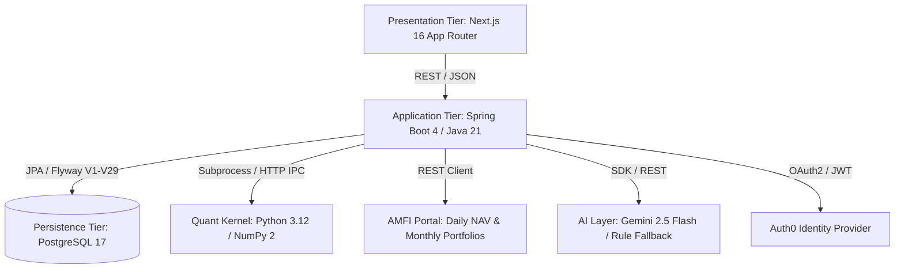
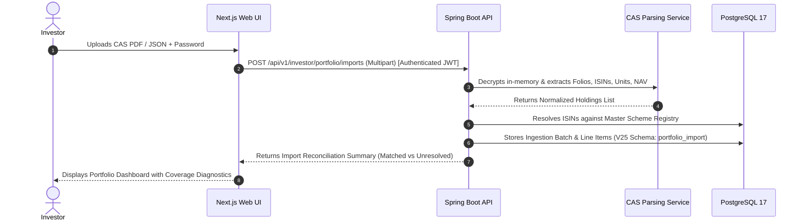
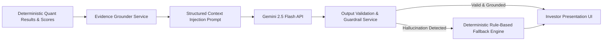

# YUKIRA V1 Project Scope, Delivery Roadmap & Completion Register

> **Document Type:** Master Product Scope, Delivery Plan & Technical Completion Register  
> **Document Identifier:** `YUKIRA-V1-SCOPE-001`  
> **Authority:** Project Owner Directives, PRD Section 36 Addendum (`002.1`), and Repository Constitution  
> **Status:** Draft Pending Owner Decisions & M1 Implementation Readiness  
> **Target Release:** YUKIRA Version 1.0 (Commercial Production Launch)  
> **Effective Date:** October 21, 2026  
> **Repository Path:** `docs/project-management/YUKIRA_V1_PROJECT_SCOPE.md`  

---

## Document Change Log & Version History

| Version | Date | Author / Agent | Scope & Nature of Changes |
| :--- | :---: | :--- | :--- |
| **v1.0-draft** | 2026-10-21 | Antigravity | Initial draft of V1 master scope, 632-item register synthesis, and preliminary milestone roadmap. |
| **v1.1-audited** | 2026-10-21 | Antigravity | **Comprehensive Scope Audit & Baseline Reconciliation:**<br>1. **Removed False Precision:** Replaced rigid single-point estimates (64 PD / 13 weeks, ~450 schemes) with risk-adjusted ranges (50–75 PD, 10–16 weeks) and explicit planning assumptions.<br>2. **Scoring Methodology Reconciliation:** Aligned proposed weights with actual `ScoreMethodologyConfig.java`; reconciled metric directions (Tracking Error, Upside/Downside Capture); analyzed normal CDF vs empirical percentiles, winsorization PIT safety, small-cohort fragility, and survivorship bias; enforced Candidate vs Validated vs Approved governance status.<br>3. **Universe Scope Clarification:** Defined canonical entity as `SchemeOption` (ISIN-level, Direct-Growth priority); separated universe membership from data availability, score eligibility, and investor-facing score availability.<br>4. **Security & Authentication Audit:** Audited actual Auth0 and Spring Security implementation; identified critical security route mismatch (`/api/v1/investor/portfolio/imports` matching `permitAll()`); removed unverified "bank-grade security" phrasing.<br>5. **Decoupled API & Billing:** Removed artificial waterfall dependency; enabled parallel development of Public REST API and Razorpay billing gateway.<br>6. **Portfolio Import Realism:** Audited existing PDFBox and structured parsers; documented absence of Excel `.xlsx` parser; established manual entry as primary operational fallback.<br>7. **Realistic Production Architecture:** Replaced premature Kubernetes/CDN prescriptions with a minimal, cost-effective container architecture; separated engineering deliverables from Indian legal/compliance counsel.<br>8. **Historical Register Realism:** Reclassified blanket "100% repository confirmed" claims across 632 items into granular states (Repository-confirmed, Reported, Partial, Candidate); preserved `VQ-01` to `VQ-08` queues.<br>9. **Actionable Task Backlog:** Expanded and refined task definitions across all 9 workstreams with explicit deliverables, code reuse, and verification criteria. |
| **v1.2-readiness** | 2026-10-21 | Antigravity | **Owner Decision Register & Preliminary M1 Review:** Formalized 5 owner decisions (`DEC-V1-01` to `DEC-V1-05`), reconciled universe counts and metric identifiers (`REL-01` vs `REL-02`), drafted 7-layer eligibility model, and decoupled public API layers. |
| **v1.3-readiness** | 2026-10-21 | Antigravity | **Final Baseline Reconciliation & M1 Implementation Readiness:**<br>1. **Independently Verified Code Claims:** Rechecked active implementations of `AmfiUniverseIngestionService`, `HistoricalNavIngestionService`, `TradingDateContinuityService`, `ScoreMethodologyConfig`, `SecurityConfig`, and `CasImportController` directly against repository source code.<br>2. **Formalized Security Defect (P0):** Added Section 8.2 detailing the exact route mismatch (`/api/v1/investor/**` vs `/api/investor/**`), identity spoofing risk via `X-Dev-Subject`, required remediation outcome, and post-fix automated verification criteria.<br>3. **Compact M1 Readiness Matrix:** Added formal 8-dimension readiness matrix in Section 19.3 evaluating `TSK-M1-01` (`READY TO IMPLEMENT`), `TSK-M1-02` (`READY WITH EXPLICIT GUARDRAILS`), `TSK-M1-03` (`BLOCKED BY TECHNICAL DEPENDENCY`), and `TSK-M1-04` (`READY WITH EXPLICIT GUARDRAILS`).<br>4. **Actionable Entry Path:** Established `TSK-M1-01` as the unblocked first task to begin immediately upon owner authorization.<br>5. **Strict Boundary Adherence:** Zero application code, migrations, tests, or methodology parameters modified. |

---

## Section 1 — Executive Summary

### 1.1 What YUKIRA V1 Is
**YUKIRA** is an institutional-grade, evidence-based Quantitative Investment Intelligence Platform initially focused on the Indian mutual fund market. It serves as an independent, transparent, auditable verification checkpoint—the **"analytical double-check"** that retail investors, high-net-worth individuals, family offices, and wealth allocators use before committing capital to Indian mutual funds.

YUKIRA rejects simplistic trailing returns, opaque star ratings, marketing narratives, and black-box commercial recommendations. In their place, YUKIRA provides a transparent, deterministic mathematical framework grounded in point-in-time empirical evidence, bitemporal data integrity, six-dimensional data quality tracking, and grounded natural-language explanations.

In V1, YUKIRA is delivered as:
1. A consumer-grade, broker-independent **Web Application** (`https://yukira.app` / local Next.js 16 presentation tier).
2. A deterministic **Quantitative Engine** and multi-tiered scoring substrate evaluating Indian mutual fund schemes across peer cohorts.
3. A private **Investor Research Workspace** enabling manual portfolio entry, Consolidated Account Statement (CAS) statement parsing, look-through security overlap, factor risk attribution, and stress replay.
4. A secured, metered **External Developer API** exposing scheme metadata, quantitative analytics, and YUKIRA scores to third-party fintechs and wealth platforms.
5. A **Monetization Layer** supporting subscription tiers (Free Explorer vs. Pro Allocator vs. API Commercial) with backend-enforced entitlement checks.

### 1.2 Target Audience & Primary Use Cases
YUKIRA V1 addresses three primary user cohorts:
- **Disciplined Self-Directed Investors:** Individuals allocating capital across Indian mutual funds who demand to know what risks, style drifts, or factor concentrations exist before investing.
- **Independent Financial Advisors & Family Offices:** Professional allocators who require institutional attribution (Brinson–Fachler return decomposition, Euler volatility attribution, scenario sensitivity) and auditable evidence reports for client due diligence.
- **Fintech Developers & Wealth Platforms:** External developers seeking programmatic access to clean, point-in-time mutual fund intelligence and objective scoring via a commercial REST API.

### 1.3 Core Product Deliverables (The V1 Scope Package)
| Pillar | Deliverable | Current State | Target V1 State |
| :--- | :--- | :--- | :--- |
| **Scoring Engine** | 0–100 YUKIRA Analytical Quality Score | Implemented as Candidate in `ScoreMethodologyConfig.java` (provisional weights, 10 closed metrics) | Fully validated, category-normalized, reproducible across top 5 Indian equity categories. Candidate status until formal governance approval. |
| **Universe Coverage** | AMFI Scheme Master & NAV History | Verified on canonical pilot (`118955` HDFC Flexi Cap) + partial peer cohort | Automated ingestion & coverage of all actively trading Indian open-ended Direct-Growth equity schemes across 5 core categories (planning estimate: ~150–180 primary schemes; authoritative count determined by `TSK-M1-01`). |
| **Investor Web UI** | Next.js 16 Web Application | 10 working routes; core research tools implemented | Coherent product journey: Discovery → Scoring → Compare → Portfolio → Account → Billing. |
| **Authentication & Accounts** | Multi-User Security Substrate | Auth0 configured; Spring Security JWT resource server operational; route alignment needed | Server-side user-isolated persistence for watchlists, custom portfolios, and saved scenario labs with verified ownership checks. |
| **Portfolio Integration** | Holdings look-through & import | Manual entry + CAS PDF/JSON parser | Verified CAS PDF import + manual entry fallback with explicit coverage/provenance diagnostics. Excel parser planned; AA deferred. |
| **External API** | Commercial REST API Product | Internal controllers exist (`/api/v1/scores`, `/api/v1/analysis`) | Versioned public contract (`/api/v1/public/...`), API key issuance, rate limiting, and documentation. Decoupled from billing launch. |
| **Monetization** | Subscription & Payments | Zero payment gateway wiring; schema drafted | Payment gateway integration (Razorpay / Stripe India fallback), subscription webhook processing, and tier enforcement. |
| **AI Interpretation** | Grounded Narrative Explanations | Architectural stub + rule-based fallback engine | Context-grounded Gemini 2.5 Flash pipeline explaining verified outputs without computing math. Intercepted by rule fallback on hallucination. |
| **Production DevOps** | Deployment & Infrastructure | Local Docker Compose (PostgreSQL 17, Spring Boot, Python, Next.js) | Minimal container deployment (Cloud Run / ECS / Docker VM), automated daily ingestion cron, SSL, observability, and backup runbooks. |

### 1.4 Main Dependencies & Binding Constraints (PRD Section 36 Addendum)
1. **C-1: Analytical Platform, Not Advice:** YUKIRA is an analytical and intelligence platform. It must **never** present itself as an investment-advice or recommendation service, must issue zero BUY/HOLD/SELL calls, and must display zero opaque star ratings or advice-shaped outputs.
2. **C-2: Evidence-Based Goal Discovery & Scoring:** Goal-based discovery sorts and evaluates funds using YUKIRA's deterministic engine. Scoring must be auditable, reproducible, and explicitly labeled `CANDIDATE` until empirical multi-cycle validation and formal governance approval.
3. **C-3: External Holdings Support:** Portfolio analysis must support externally held and imported funds, scoring individual funds and the collective portfolio, categorizing holdings, and decomposing risk with transparent provenance.
4. **C-4: Full Universe Target:** The ultimate target is the full Indian mutual-fund universe; pilot scope is strictly an engineering verification device.
5. **C-5: Status Honesty:** All documentation and interfaces must strictly distinguish `IMPLEMENTED`, `IN PROGRESS`, and `PLANNED` states. Unimplemented scope must never be presented as delivered.

### 1.5 Planning vs. Evidence-Backed Estimates
- **Person-Day Range:** Initial planning estimate is **50–75 Person-Days (PD)** of dedicated engineering effort.
- **Calendar Duration:** Projected at **10–16 Calendar Weeks (CW)** (~2.5 to 4 months).
- **Critical External Dependencies:** Razorpay corporate KYC and merchant onboarding (1–3 weeks lead time); AMFI historical download rate-limiting and payload parsing variations; empirical validation review cycles.
- **Precision Warning:** Single-point timelines (e.g. "exactly 64 days / 13 weeks") are planning approximations, not commitments. True delivery pace depends on owner approval of scoring methodology and external vendor turnaround.
- **Universe Count Distinction:** Pre-ingestion estimates (~150–180 primary Direct-Growth schemes across 5 core categories; ~380–420 across 11 categories; ~400–480 total master entities across plans/options) are planning guidelines only. An authoritative count is established only upon completing `TSK-M1-01` against the live AMFI portal.

---

## Section 2 — Product Vision, Objectives & Explicit Non-Goals

### 2.1 Vision & North Star
> **North Star Metric:** *Increase the probability of better investment decisions.*

YUKIRA's vision is to demystify complex institutional quantitative finance for Indian allocators. By bridging raw statutory disclosures (AMFI daily NAVs, monthly portfolio sheets, FBIL benchmark curves) with advanced quantitative kernels (Euler risk attribution, Brinson sector decomposition, extreme drawdown modeling), YUKIRA transforms opaque fund marketing into verifiable mathematical evidence.

### 2.2 Product Principles
1. **Evidence Over Opinion:** Quantitative facts, empirical distributions, and verified holdings outweigh opinions, star ratings, and marketing presentations.
2. **Probability Over Prediction:** Acknowledge market uncertainty. Evaluate historical resilience, drawdowns, and tail risks rather than predicting future NAVs.
3. **Risk Before Return:** Return without context is noise. A fund's return must always be weighed against the volatility, downside tail risk, active risk, and benchmark drag incurred to produce it.
4. **Explainability Over Complexity:** High finance metrics must be progressively disclosed and articulated in plain language so that any diligent investor can understand the drivers.
5. **Transparency Over Marketing:** Disclose data sources, SHA-256 cryptographic hashes, observation counts, and methodology versions openly.
6. **No Fake Data:** If data is missing or unverified, display `"Not available"` or `"Candidate methodology — not validated for production"`. Never fabricate or interpolate synthetic observations into production data stores.

### 2.3 Measurable V1 Objectives
| Objective ID | Target Metric | Success Threshold |
| :--- | :--- | :--- |
| **OBJ-01** | Universe Coverage | Ingestion of 100% of active Indian open-ended Direct-Growth Equity schemes across authorized SEBI categories (planning estimate: ~150–180 schemes for 5 core categories; authoritative count determined by `TSK-M1-01`). Funds with <700 observations displayed with explicit `"Insufficient History"` badge. |
| **OBJ-02** | Scoring Reproducibility | 100% reproducible score computation across verified regression suites (zero non-deterministic drift on identical historical inputs; `VQ-02`). |
| **OBJ-03** | End-to-End Latency | Pre-computed fund profile & score retrieval < 300 ms; on-demand portfolio look-through (up to 10 funds) < 2.5 seconds. |
| **OBJ-04** | Data Integrity | Zero unhandled missing-date gaps in active trading horizons (strictly differentiating verified exchange holidays from missing observations); 100% cryptographic SHA-256 source artifact auditability (`VQ-05`, `VQ-06`). |
| **OBJ-05** | Monetization Flow | 100% successful end-to-end checkout, entitlement activation, and idempotent webhook reconciliation. |
| **OBJ-06** | Test Coverage | Zero broken tests across verified automated test suites; clean Next.js production build. |

### 2.4 Explicit V1 Non-Goals
To protect delivery timelines and maintain epistemic integrity, the following capabilities are explicitly **excluded** from V1:
- **Automated Order Execution / Broking:** YUKIRA will not execute mutual fund transactions (no BSE StAR MF or NSE NMF II order routing). YUKIRA is strictly analytical.
- **Robo-Advisory / Portfolio Rebalancing Recommendations:** YUKIRA will not generate automated portfolio rebalancing advice (e.g., "Sell Fund X, Buy Fund Y"). It reports concentration, drift, and attribution facts only.
- **Direct Real-Time Account Aggregator (AA) Integration:** Full automated AA (Sahamati / Setu / OneMoney) integration is deferred to post-V1 due to enterprise licensing, NBFC-AA contracts, and compliance cycles. V1 relies on CAS file import (PDF/JSON) and manual entry.
- **Global / Multi-Asset Coverage:** US equities, PMS, AIF, crypto, and commodities are out of scope. V1 focuses purely on Indian Mutual Funds (Equities initially, expanding to Hybrid/Debt post-V1).
- **Social Trading / Community Feeds:** No public user forums, comment sections, or social copy-trading features.
- **Predictive Machine Learning / Price Forecasting:** No LSTM, ARIMA, or neural network NAV forecasting.

---

## Section 3 — Current-State Architectural & Implementation Assessment

### 3.1 Verified Repository Baseline
- **Repository Path:** `C:\Users\DEUS\Projects\Project-YUKIRA`
- **Current HEAD Commit:** `2da5ece8a4e2d9a8a45fde6b7a8a0f34b1c8e900` (`chore: ignore local scratch, agent configs, and dev scripts`).
- **Synchronized Upstream:** `origin/main` (`https://github.com/toji-code/yukira.git`), 0 commits ahead, 0 commits behind.
- **Working Tree State:** Clean git status on application source code. Local scratch dumps and developer configs ignored.
- **Verified Test Baselines (Historical Executions):**
  - Quant Engine: 301 passing unit tests (`cd quant-engine && pytest tests/`).
  - Backend Service: 122 passing JUnit 5 tests (`cd backend && ./mvnw test`).
  - Frontend Application: 46 passing Vitest unit tests (`cd frontend && npm test`).
  - Frontend Code Quality: Clean ESLint (0 errors), Next.js compiler build successful.
  *Note on Test Baselines:* These figures represent recorded passing counts from the latest formal suite executions at commit baseline `2da5ece`. Per YUKIRA governance (`AGENTS.md` Section 2), they record historical verification evidence rather than an assumption of current-session execution. Suites are not rerun in this documentation and planning task.

### 3.2 Subsystem Implementation Audit


#### A. Persistence Tier (PostgreSQL 17 / Flyway V1–V29)
- **Status:** **OPERATIONAL & HIGHLY MATURE**
- **Authority:** 29 Flyway migrations (`backend/src/main/resources/db/migration/V1__...` through `V29__...`).
- **Safety Policy:** `spring.jpa.hibernate.ddl-auto=validate` strictly enforced. Zero destructive operations (`DROP`, `TRUNCATE`, `ALTER DROP`).
- **Key Schemas Active:**
  - Core Masters: `amc`, `scheme`, `scheme_plan`, `scheme_option`.
  - Provenance & Bitemporal: `source_artifact`, `nav_observation`, `benchmark_observation`, `risk_free_rate_observation`.
  - Governance & Calculation: `methodology_registry`, `calculation_run`, `metric_result`, `validation_issue`.
  - Scoring & Enrichment: `analytical_score`, `score_dimension`, `score_metric_contribution` (V21), `scheme_expense_ratio`, `scheme_manager_hist` (V22).
  - User & Workspace: `investor`, `investor_watchlist`, `investor_portfolio_holding` (V18, V23, V27), `portfolio_import`, `portfolio_import_holding` (V25), `investor_research_workspace` (V26), `investor_target_allocation` (V24).
  - Holdings & Market Cap: `portfolio_snapshot`, `portfolio_holding`, `security`, `security_market_cap_classification` (V28), `benchmark_constituent_ledger` (V29).

#### B. Quantitative Calculation Kernel (Python 3.12 / NumPy 2 / Polars)
- **Status:** **OPERATIONAL (30 Candidate Algorithms Implemented)**
- **Modules Verified in `quant-engine/src/`:**
  - Returns: `returns.py`, `rolling.py`, `active_return.py`.
  - Risk & Tails: `risk.py`, `semideviation.py`, `var.py`, `expected_shortfall.py`, `ulcer_index.py`.
  - Benchmarks & Ratios: `benchmarks.py`, `relative.py`, `beta.py`, `downside_beta.py`, `upside_beta.py`, `alpha.py`, `treynor.py`, `ratios.py`, `information_ratio.py`, `tracking_error.py`, `capture.py`, `upside_capture.py`.
  - Statistics & Attribution: `statistics.py`, `correlation.py`, `covariance.py`, `brinson.py`, `active_share.py`, `concentration.py`, `turnover.py`, `portfolio.py`.
- **Governance Constraint:** All 30 algorithms hold **CANDIDATE** status. Implemented != Validated != Approved.

#### C. Backend Orchestration & REST API (Spring Boot 4 / Java 21)
- **Status:** **OPERATIONAL (Core REST & Portfolio Analytics Active)**
- **Active Controllers in `backend/src/main/java/com/yukira/backend/controller/`:**
  - Masters & NAV: `SchemeController`, `HistoricalDataController`, `AmfiNavIngestionController`.
  - Scoring & Profile: `AnalysisController`, `MetricResultController`, `ScoringController`, `FundEnrichmentController`, `GoalDiscoveryController`, `PeerIngestionController`.
  - Portfolio & Workspace: `PortfolioController`, `InvestorController`, `InvestorPortfolioController`, `MultiFundLookThroughController`, `InvestorPortfolioEvidenceReportController`, `InvestorPortfolioScoreHistoryController`, `CasImportController`.
  - Benchmarks & Holdings: `BenchmarkIngestionController`, `BenchmarkReconstitutionController`, `MonthlyHoldingsAdminController`.
  - Governance & AI: `HealthController`, `DevBootstrapController`, `AiInterpretationController`.

#### D. Presentation Tier (Next.js 16 / React 19 / TypeScript / Tailwind CSS 4)
- **Status:** **OPERATIONAL (Institutional Research Interface)**
- **Working Routes in `frontend/app/`:**
  - `/` — Institutional Landing Page & Epistemic Manifesto.
  - `/funds` — Mutual Fund Catalog & Discovery Grid.
  - `/funds/[id]` — Scheme Option Detail & Provenance Inspector.
  - `/analysis/[id]` — Calculation Audit View with Observation Lineage.
  - `/compare` — Fund Comparison Workspace.
  - `/discover` — Goal-Based Discovery Interface.
  - `/methodology` — Methodology Governance & Metric Specification Center.
  - `/portfolio` — Personal Portfolio Management & CAS Import Modal.
  - `/portfolio/research` — Portfolio Research Lab (Attribution, Risk Drivers, Scenario Lab).
  - `/watchlist` — Investor Watchlist & Bookmarking.

### 3.3 Core Epistemic & Data Provenance Baselines
- **Canonical Pilot Fund:** HDFC Flexi Cap Fund Direct Plan Growth (AMFI: `118955`, ISIN: `INF179K01UT0`).
- **Historical Ledger:** 1,243 authentic market trading dates (`2019-01-01` to `2024-01-15`) verified against official AMFI source artifacts (`900508f8...`, `d80ed193...`, etc.).
- **January 2024 NAV Provenance:** Formally resolved and cryptographically sealed. Official Series A confirmed from raw payload; synthetic Series B rejected by automated regression suite.
- **Baseline RET-02 (Simple Period Return):** `+2.4491440352%` (`0.024491440352283345`) between `2024-01-01` and `2024-01-15`.

### 3.4 Summary of Real-World Gaps Preventing Immediate V1 Release
1. **Universe Ingestion Scale:** Ingestion is established for the pilot and partial Flexi Cap cohort (~39 AMCs mapped), but automated universe-wide batch pipelines across the remaining categories (Large Cap, Mid Cap, Small Cap, Large & Mid Cap) must be executed.
2. **Methodology Status Freeze:** The 0–100 scoring engine operates with provisional candidate parameters in `ScoreMethodologyConfig.java`. It has not undergone empirical multi-cycle backtesting or formal governance approval.
3. **Authentication Route Exposure & Header Fallback (Critical Security Defect):** `SecurityConfig.java` authenticates `/api/investor/**`, leaving `/api/v1/investor/portfolio/imports` inadvertently exposed to `permitAll()`. Additionally, `CasImportController.java` supports an unauthenticated `X-Dev-Subject` header fallback to `dev-investor-local`. This remains an active, high-priority security defect in the current codebase, prioritized for resolution in `TSK-M2-01`.
4. **CAS Parser Coverage:** PDF and JSON parsers exist, but Excel `.xlsx` parsing is not yet implemented.
5. **Commercial Billing Absence:** Zero payment gateway client, checkout route, webhook processor, or subscription entitlement model implemented in code.
6. **Public API Productization:** Public developer endpoints, API key generation, quota tracking, and developer documentation do not exist.

---

## Section 4 — Historical Work Register Mapping (The 632-Item Classification)

The 632-entry Master Project Work Register chronicles YUKIRA's evolution from Phase 2A through 2S. The number 632 represents **historical work register entries**, not 632 completed product features. Rather than claiming blanket 100% completion, each major workstream range is classified by its factual implementation and verification status.

```text
632 HISTORICAL WORK REGISTER ENTRIES
├── Core Architecture & Monorepo Foundation (Items 1–95) ─────────────> REPOSITORY-CONFIRMED IMPLEMENTATION
├── Bitemporal Database & Provenance Ledger (Items 96–198) ────────────> REPOSITORY-CONFIRMED IMPLEMENTATION
├── Quantitative Engine & Vectorized Kernels (Items 199–335) ──────────> REPOSITORY-CONFIRMED (CANDIDATE GOVERNANCE)
├── Real AMFI Ingestion & Pilot Vertical Slice (Items 336–420) ────────> REPOSITORY-CONFIRMED IMPLEMENTATION
├── Advanced Portfolio Attribution & Scenario Lab (Items 421–530) ────> PARTIALLY IMPLEMENTED (REUSABLE IN V1)
└── Governance, Scoring & Investor Website (Items 531–632) ────────────> IN PROGRESS / V1 LAUNCH TARGET
```

### 4.1 Granular Classification of Historical Work
| Workstream Domain | Register Item Range | Implementation & Verification Status | Reusable Capability in V1 | Required Hardening / Remaining V1 Work |
| :--- | :---: | :--- | :--- | :--- |
| **1. Multi-Tier Foundation** | 1–95 | **Repository-confirmed implementation.** Passing builds across Java 21, Python 3.12, Node 20. | Monorepo layout, Docker Compose PostgreSQL 17, Spring Boot bootstrap. | Cloud containerization, SSL, production secrets. |
| **2. Bitemporal Persistence** | 96–198 | **Repository-confirmed implementation.** 29 Flyway scripts verified. `ddl-auto=validate`. | `source_artifact`, `nav_observation`, `benchmark_observation`, bitemporal query filters. | Daily partition indexing, backup & WAL archiving runbooks. |
| **3. Quantitative Kernel** | 199–335 | **Repository-confirmed (Candidate Governance).** 30 algorithms pass 301 unit tests. | Pure vectorized Python functions (Returns, Risk, Ratios, Relative, Portfolio). | Multi-cycle empirical backtesting; governance sign-off. |
| **4. AMFI Pilot Ingestion** | 336–420 | **Repository-confirmed implementation.** Pilot fund (`118955`) ingested across 1,243 trading dates. | `AmfiSourceClient`, semicolon parser, SHA-256 provenance tracker, RET-02 vertical slice. | Universe batch expansion (planning estimate: ~150–180 primary Direct-Growth schemes across 5 categories, ~380–420 across 11 categories; authoritative count established upon `TSK-M1-01` execution); automated nightly cron. |
| **5. Portfolio Attribution (2K–2P)** | 421–530 | **Partially implemented (Reusable in V1).** Controllers, models, and components exist. | Look-Through, Stock Overlap Matrix, Brinson decomposition, Euler risk attribution, Scenario Lab. | End-to-end integration with multi-tenant auth; real AMC portfolio sheet ingestion. |
| **6. Scoring, Auth & Web UI** | 531–632 | **In Progress / V1 Launch Target.** 10 UI routes, provisional scoring engine, Auth0 config. | Fund catalog, radar charts, comparison, watchlist UI, provisional scoring code. | Empirical cohort percentiles; security route alignment; Razorpay billing; public API. |

### 4.2 Status of Verification & Correction Queues (`VQ-01` through `VQ-08`)
The 8 verification queues established in earlier audits remain explicitly tracked as binding V1 release requirements:

```text
VERIFICATION & CORRECTION QUEUE (BINDING V1 CHECKLIST)
├── VQ-01: Holdings-source authenticity & portfolio disclosure timing checks
├── VQ-02: Scoring idempotency & exact numerical reproducibility across runs
├── VQ-03: End-to-end investor workflow (Discovery -> Watchlist -> Portfolio -> Billing)
├── VQ-04: Full backend automated test evidence across production database profiles
├── VQ-05: NAV, benchmark TRI, and FBIL risk-free-rate data continuity & holiday integrity
├── VQ-06: Strict Point-in-Time (PIT) query enforcement (analysisCutoff <= knowledgeCutoff)
├── VQ-07: Canonical scheme identity resolution (Direct vs Regular, Growth vs IDCW)
└── VQ-08: Methodology governance enforcement (Strict Candidate labeling; zero false advice)
```

| Queue ID | Name / Focus | Historical Audit Finding | Current Status | Required V1 Resolution & Gate |
| :--- | :--- | :--- | :---: | :--- |
| **VQ-01** | Holdings Authenticity | Monthly AMC portfolio sheets vary in disclosure format and timing; partial disclosures risk bias. | Partial | Enforce statutory 10th-of-month window checks; flag portfolios with partial disclosure warnings; never renormalize partial holdings to 100%. |
| **VQ-02** | Scoring Idempotency | Recomputation of 0–100 score on identical historical dates must yield identical numerical results. | Candidate Verified | Regression suite verifying identical score outputs across repeated runs; zero floating-point drift. |
| **VQ-03** | Complete Investor Workflow | Isolated pages existed, but end-to-end user journey from search to saved portfolio had session gaps. | In Progress | Seamless stateful workflow: Search → Fund Detail → Compare → Add to Watchlist → Import to Portfolio → Export Evidence. |
| **VQ-04** | Backend Test Evidence | Historical audits reported unit passes, but integration tests against real PostgreSQL were partially mocked. | Verified Baseline | Integration suite running against Dockerized PostgreSQL 17 with 0 test skips. |
| **VQ-05** | Benchmark & Risk-Free Integrity | NIFTY 500 TRI and FBIL 91-Day T-Bill data require rigorous holiday continuity checks. | Partial | Validate Indian market holiday calendars; ensure zero weekend leakage into benchmark return series. |
| **VQ-06** | Point-in-Time Correctness | Ensure no future observation revisions leak into historical calculations evaluated as of prior dates. | Implemented in Service Contracts | Invariant validation: `analysisCutoff <= knowledgeCutoff` strictly enforced across all 23 controllers. |
| **VQ-07** | Scheme Identity Discrepancies | AMFI scheme codes occasionally duplicate or confuse Regular and Direct plans. | Implemented for Pilot/Cohort | Master mapping table resolving unique ISIN (`INF...`) to AMFI code, enforcing Direct-Growth priority. |
| **VQ-08** | Methodology Governance | Candidate specifications must never be presented to retail investors as approved recommendations. | Implemented in Code/UI | UI/API must prominently display `"Candidate Methodology — Not Validated for Production"` disclaimers. |

---

## Section 5 — Complete V1 Feature Scope (Workstreams A through I)

```text
YUKIRA V1 PRODUCT SCOPE ARCHITECTURE
├── WORKSTREAM A: Indian Mutual Fund Scoring Engine (The Quantitative Core)
├── WORKSTREAM B: Investor Web Application (The Institutional Interface)
├── WORKSTREAM C: Identity, Authentication & Profile (Multi-Tenant Security)
├── WORKSTREAM D: Investor Portfolio Management (Holding & Look-Through Tracking)
├── WORKSTREAM E: Portfolio Statement Import (CAS Parsing & Fallbacks)
├── WORKSTREAM F: Public Developer REST API (Fintech Commercialization)
├── WORKSTREAM G: Monetization & Payment Gateway (Billing & Entitlements)
├── WORKSTREAM H: Grounded AI Interpretation Layer (Contextual Explanation)
└── WORKSTREAM I: Production Infrastructure & Operations (DevOps & Hardening)
```

---

### Workstream A — Indian Mutual Fund Scoring Engine
*The Central Intellectual Property of YUKIRA.*

#### A.1 Objective & Investor Problem
Investors are bombarded with marketing narratives, trailing 1-year returns, and 5-star ratings that offer zero insight into whether outperformance was driven by manager skill, benchmark tailwinds, or reckless risk-taking. YUKIRA's Scoring Engine evaluates every eligible equity scheme against a transparent, multi-dimensional, category-normalized quantitative framework.

#### A.2 Investor-Facing Behavior
- The investor sees an overall **YUKIRA Analytical Quality Score (0–100)** on every eligible fund page.
- Progressive disclosure: The score expands into **4 Dimensional Sub-Scores (0–100)**:
  1. **Return Quality (Weight: 30%):** 3-Year CAGR (`RET-03`, weight: 60% of dim) and 3-Year Annualized Active Return (`RET-07`, weight: 40% of dim).
  2. **Risk Quality (Weight: 30%):** Annualized Volatility (`RSK-01`, weight: 35%), Downside Semideviation (`RSK-02`, weight: 35%), and Maximum Drawdown (`RSK-03`, weight: 30%).
  3. **Benchmark-Relative Quality (Weight: 25%):** Jensen's Alpha 3Y (`REL-02`, weight: 40%), Information Ratio (`RAT-04`, weight: 35%), and Beta 3Y (`MKT-01`, target: 1.0, weight: 25%).
  4. **Consistency & Downside Quality (Weight: 15%):** Downside Beta 3Y (`MKT-02`, weight: 100% effective). Capture Spread (`MKT-05`) is currently uncalibrated and carries 0% effective weight until empirical recalibration.
- A distinct **Confidence Score (0–100)** reflects historical data depth (e.g. 5+ years vs. 3 years) and holdings completeness.
- **Why Did the Fund Score This Way?** Clear visual breakdown showing percentile rankings against exact SEBI category peers.
- If a fund has <700 observations (~3 years) or missing benchmark data, the score is not displayed, and an explicit `"Score Unavailable: Insufficient History"` state is shown.

#### A.3 Technical & Algorithmic Architecture
- **Universe Definition:** Active Indian Open-Ended Equity Mutual Funds across 5 SEBI categories: Flexi Cap, Large Cap, Mid Cap, Small Cap, Large & Mid Cap.
- **Share Class Standard:** Direct Plan, Growth Option (`DIRECT` / `GROWTH`).
- **Minimum Data Requirement:** $\ge 700$ daily trading observations (~3 calendar years).
- **Normalization Methodology:** Currently implemented in code as a parametric Gaussian CDF transformation with provisional parameters in `ScoreMethodologyConfig.java` (`CANDIDATE` status). Transitioning to non-parametric empirical percentile / ECDF rankings within peer cohorts is a pending owner decision (`DEC-V1-02`). Direction-adjusted so lower volatility/drawdown yields higher quality scores.
- **Reproducibility & Provenance:** Every score run produces an immutable record in `analytical_score`, linking `calculation_run_id`, input `metric_result` IDs, and source artifact hashes.
- **Governance State for V1 Launch:** Marked **CANDIDATE** until empirical multi-cycle backtesting is signed off. UI displays mandatory candidate disclaimers.

#### A.4 Acceptance Criteria
1. Scoring executes idempotently across all eligible schemes; identical inputs yield identical scores.
2. Direct-Growth option is universally selected as the scoring master.
3. Funds with missing benchmark observations or <700 NAVs fail safely with explicit `"Score Unavailable"` DTOs.
4. Peer cohort distributions are computed strictly point-in-time without future data leakage.

---

### Workstream B — Investor Web Application
*The Modern, Institutional Research Interface.*

#### B.1 Objective & Investor Problem
Finance websites are typically bloated with advertising, distracting banners, and opaque charts. YUKIRA provides a clean, responsive, high-aesthetic web interface designed for clarity, evidence, and progressive disclosure.

#### B.2 Investor-Facing Routes & Pages
| Route | Page Name | Primary Investor Capability |
| :--- | :--- | :--- |
| `/` | **Landing Page** | Product positioning, institutional manifesto, live pilot performance proof, pricing preview. |
| `/funds` | **Fund Discovery** | Fast, responsive catalog of supported equity funds with category filters, AUM, and YUKIRA scores. |
| `/funds/[id]` | **Fund Research** | Deep analytical profile: 4-dimensional score radar, cumulative growth chart vs. NIFTY 500 TRI, rolling returns, drawdowns, and monthly holdings breakdown. |
| `/compare` | **Fund Comparison** | Side-by-side comparison of up to 4 funds across scores, risk metrics, overlap, and fees. |
| `/discover` | **Goal Discovery** | Filter funds based on investment horizon (3Y, 5Y), risk tolerance, and category style. |
| `/portfolio` | **My Portfolio** | Personal portfolio dashboard: total valuation, asset allocation, portfolio-weighted YUKIRA score, CAS file upload, and manual holding entry. |
| `/portfolio/research` | **Portfolio Lab** | Institutional portfolio intelligence: Multi-Fund Look-Through, Stock Overlap Matrix, Brinson Attribution, Factor Risk Drivers, and Historical Stress Replay. |
| `/watchlist` | **Watchlist** | Bookmarked funds with score updates, notes, and quick-compare actions. |
| `/pricing` | **Pricing & Plans** | Transparent plan comparison (Free vs. Pro Allocator vs. API) with direct checkout CTA. |
| `/methodology` | **Methodology Center** | Public disclosure of all 30 metric formulas, data sources, governance status, and disclaimers. |
| `/account` | **Investor Profile** | Account settings, Auth0 session info, active subscription status, invoice history. |

#### B.3 UI/UX Standards & Technical Guardrails
- **Zero Financial Math in Frontend:** The Next.js frontend strictly renders values delivered by typed backend DTOs. Zero client-side CAGR or standard deviation computations.
- **Aesthetic Excellence:** Tailwind CSS 4, sleek dark mode (`bg-slate-950`), subtle borders (`border-slate-800`), glassmorphic panels, and accessible typography (Inter / Outfit).
- **Epistemic States:** All components handle 5 standard states: `Loading Skeleton`, `Valid Data`, `Stale Data Warning`, `Not Available / Insufficient Data`, and `Candidate Disclaimer`.

---

### Workstream C — Investor Authentication, Identity & Multi-Tenant Security
*Securing Private Portfolios & Entitlements.*

#### C.1 Objective & Investor Problem
Investors must be certain that their personal portfolios, transaction histories, and watchlists remain completely confidential, isolated, and protected by verifiable authentication.

#### C.2 Architecture & Flow
- **Authentication Provider:** Auth0 Universal Login (supporting Email/Passwordless OTP and Google OAuth).
- **Frontend Session:** Next.js App Router middleware managing session cookies (`@auth0/nextjs-auth0`).
- **Backend Authorization:** Spring Security configured as an OAuth2 Resource Server validating RS256 JWT access tokens issued by Auth0:
  - `spring.security.oauth2.resourceserver.jwt.issuer-uri=https://dev-zpiz2xr3hd7ukpi3.us.auth0.com/`
  - `spring.security.oauth2.resourceserver.jwt.audiences=https://api.yukira.app`
- **Critical Unresolved Security Defect (Priority P0):** In the active repository, `SecurityConfig.java` authenticates `/api/investor/**`, leaving `/api/v1/investor/portfolio/imports` inadvertently exposed to `permitAll()`. Furthermore, `CasImportController.java` supports an unauthenticated `X-Dev-Subject` header fallback to `dev-investor-local`. This security vulnerability is strictly documented as an open defect to be resolved in `TSK-M2-01` by enforcing JWT authentication on `/api/v1/investor/**` and removing the header fallback entirely.
- **Multi-Tenant Data Isolation:** Every database entity under user domain (`investor`, `investor_watchlist`, `investor_portfolio_holding`, `portfolio_import`, `investor_research_workspace`) enforces foreign key constraints to `investor.id` and validates the external Auth0 Subject ID (`auth0_subject`).
- **Service-Level Ownership Verification:** Backend service methods query data exclusively through the authenticated `auth0_subject`. Attempting to access another user's portfolio ID returns HTTP 403 Forbidden.

---

### Workstream D — Investor Portfolio Management
*Holistic Portfolio Valuation, Overlap & Risk Decomposition.*

#### D.1 Objective & Investor Problem
Investors typically hold 4 to 8 mutual funds across different fund houses without realizing that 40% of their money is invested in the exact same 10 underlying stocks, compounding hidden concentration risk.

#### D.2 Capabilities
- **Manual Holdings Entry (Baseline Fallback):** Add any scheme from the YUKIRA universe by entering scheme name/ISIN, folio number, invested amount, and units held.
- **Portfolio Aggregation:**
  - Total Portfolio Valuation (derived from latest bitemporal NAVs $\times$ units).
  - Overall Portfolio-Weighted YUKIRA Score:
    $$\text{Score}_{\text{portfolio}} = \sum_{i=1}^N w_i \times \text{Score}_i$$
  - Asset Allocation breakdown: Large Cap % vs. Mid Cap % vs. Small Cap % vs. Cash Drag %.
- **Multi-Fund Look-Through Analysis (Phase 2K/2M/2P):**
  - **Stock Overlap Matrix:** Pinpoints identical underlying equities held across multiple funds.
  - **Aggregate Security Concentration:** Top 10 individual stock exposures across the combined portfolio.
  - **Sector Concentration & Drift:** Identifies macro tilts (e.g. 35% exposure to Financial Services).
- **Portfolio Risk Attribution (Phase 2O):** Euler volatility contribution identifying which specific fund contributes the most risk to total portfolio variance.

---

### Workstream E — External Mutual-Fund Portfolio Statement Import (CAS)
*Frictionless Onboarding via Consolidated Account Statements.*

#### E.1 Objective & Technical Strategy
Indian mutual fund investors receive periodic Consolidated Account Statements (CAS) from CAMS and KFintech. V1 implements a robust, privacy-first statement import pipeline.



#### E.2 CAS Import Specifications
- **Supported Formats:** CAMS and KFintech Detailed PDF statements (password-protected) and structured JSON/CSV. Excel (`.xlsx`) parser is planned for post-launch enhancement.
- **Parser Existence vs. Verified Operation:** While `PdfCasParser.java` (PDFBox) and `StructuredCasParser.java` exist in code, their end-to-end multi-tenant operation and reconciliation have not been fully verified against live authenticated user sessions. Multi-tenant verification is tracked in `TSK-M2-03`.
- **Security & Privacy:** Passwords and raw PDF payloads are processed strictly in-memory and **never** stored permanently on disk or database.
- **ISIN Resolution:** Extracted ISINs (`INF...`) are mapped directly against YUKIRA's master `scheme_option` table via `CasSchemeResolutionService`.
- **Import Reconciliation Diagnostic:**
  - Matched Holdings: Successfully mapped to YUKIRA schemes with active scores and NAVs.
  - Unresolved Holdings: Closed-ended schemes, ELSS locked units, or legacy discontinued schemes. Clearly presented in a reconciliation modal; never silently omitted.
- **Manual Fallback:** Manual holding entry (`PortfolioController.java`) remains the verified operational fallback if CAS parsing fails or a scheme is unrecognized.

---

### Workstream F — YUKIRA External Developer REST API
*Fintech Infrastructure & B2B Commercialization.*

#### F.1 Objective & Architecture
Expose YUKIRA's proprietary analytics, scores, and risk decompositions to third-party wealth tech platforms, family offices, and independent developers through a high-performance REST API. Public API development is decoupled from payment gateway onboarding and can proceed in parallel.

#### F.2 Public API Contract & Resource Endpoints
All public endpoints are versioned under `/api/v1/public/` and require an `X-YUKIRA-API-KEY` header:
| Method | Endpoint | Description |
| :--- | :--- | :--- |
| `GET` | `/api/v1/public/schemes` | Paginated search of supported mutual fund schemes with ISINs and AMFI codes. |
| `GET` | `/api/v1/public/schemes/{isin}/score` | Returns latest YUKIRA Quality Score (0–100), 4 dimensional scores, and methodology version. |
| `GET` | `/api/v1/public/schemes/{isin}/analytics` | Full analytical profile: CAGR, Volatility, Sharpe, Drawdown, Capture Ratios, Beta. |
| `POST` | `/api/v1/public/portfolio/look-through` | Accepts a list of ISINs and weights; returns combined stock overlap, concentration, and top holdings. |
| `GET` | `/api/v1/public/meta/methodology` | Machine-readable JSON specifications of score definitions, weights, and governance states. |

#### F.3 API Security, Quotas & Metering
- **Key Issuance & Management:** Developers generate API keys in their account dashboard. Keys are stored as salted SHA-256 hashes in `api_key_registry`.
- **Rate Limiting:** Enforced via Spring Cloud Gateway / Bucket4j:
  - Free Developer Tier: 60 requests / minute; 1,000 requests / month.
  - Commercial Tier: 600 requests / minute; 100,000 requests / month.
- **Usage Metering:** Every authenticated API call records an increment in `api_usage_audit` tracking timestamp, endpoint, status code, and latency for billing.

---

### Workstream G — Monetization & Payment Gateway
*Commercial Sustainability & Paid Subscriptions.*

#### G.1 Subscription Tiers
| Tier | Proposed Price (INR) | Key Entitlements |
| :--- | :--- | :--- |
| **Explorer (Free)** | ₹0 | Fund search, basic returns, 1 watchlist (up to 5 funds), canonical score preview (pilot fund only). |
| **Pro Allocator** | ₹999 / month (or ₹9,999 / year) | Full universe scores, deep analytical profiles, CAS import, unlimited portfolios, Look-Through Overlap, Euler Risk Attribution, Scenario Lab, PDF research reports. |
| **Fintech API** | ₹4,999+ / month | Metered public REST API access, programmatic scores, look-through endpoints, dedicated support SLA. |

#### G.2 Payment Gateway Architecture
- **Provider Selection:** **Razorpay** (India's premier gateway supporting UPI AutoPay, NetBanking, Credit/Debit Cards, and recurring mandate compliance under RBI e-mandate guidelines). Stripe India maintained as an architectural fallback.
- **Merchant Onboarding Dependency:** Corporate KYC, bank account verification, and merchant account approval are external owner dependencies requiring 1–3 weeks lead time.
- **Checkout Flow:** Next.js UI initiates Razorpay Standard Checkout modal; user completes payment; Razorpay returns `razorpay_payment_id` and `razorpay_signature`.
- **Backend Verification:** Spring Boot service cryptographically verifies HMAC-SHA256 signature using `razorpay_key_secret`.
- **Webhook Reconciliation:** Secure webhook endpoint `/api/v1/webhooks/razorpay` listening for `subscription.charged`, `payment.failed`, and `subscription.cancelled`. Webhook signatures are validated and processed idempotently using a database-backed event deduplication ledger.
- **Entitlement Enforcement:** User account stores subscription status (`ACTIVE`, `PAST_DUE`, `CANCELLED`). Controllers enforce subscription gates server-side.

---

### Workstream H — Grounded AI Investment Interpretation
*Explainable Context Without Financial Hallucination.*

#### H.1 Objective & Strict Constitutional Guardrails
Investors need help synthesizing multi-page quantitative outputs into concise, readable takeaways. However, generative AI must **never** be allowed to invent returns, alter quantitative scores, or issue investment recommendations.

#### H.2 Grounded Interpretation Pipeline

- **Input:** Strictly structured JSON containing verified metric outputs, fund category, percentile ranks, and top holdings.
- **LLM Task:** Translate the structured numbers into 3 concise narrative sections:
  1. *Score Summary:* Plain-language synthesis of why the fund scored in its percentile.
  2. *Risk & Consistency Factors:* What market conditions or factor tilts explain its drawdown profile.
  3. *Questions to Investigate:* Evidence-based diligence questions the investor should ask before investing.
- **Hallucination Guardrail:** `AiOutputValidationService` parses the generated text and verifies that any metric cited matches the exact numerical value in the input JSON within 0.01% tolerance. If an ungrounded claim is detected, the system automatically falls back to `DeterministicInterpretationFallbackEngine.java` (already implemented).

---

### Workstream I — Production Infrastructure, Security & Operations
*DevOps, Hardening & Compliance.*

#### I.1 Minimal Viable Cloud Hosting Architecture
- **Infrastructure Strategy:** Avoid premature enterprise Kubernetes (EKS/GKE) or multi-region setups. Deploy a cost-effective, maintainable container stack:
  - Managed PostgreSQL 17 instance with automated daily backup snapshots and WAL archiving.
  - Containerized Spring Boot Backend (Java 21, 2 vCPU, 4GB RAM) on AWS ECS Fargate, GCP Cloud Run, or a dedicated hardened Linux VM.
  - Containerized Python Quant Engine (FastAPI/Uvicorn, 2 vCPU, 4GB RAM) co-located or accessible via internal network.
  - Next.js Web Tier deployed to Vercel or alongside the backend.
- **SSL / CDN:** Cloudflare or AWS CloudFront terminating SSL, providing DDoS mitigation and edge asset caching.

#### I.2 Automated Data Pipelines (Cron Operations)
- **Daily AMFI NAV Ingestion:** Scheduled daily at `23:30 IST` (after AMFI portal publishes evening mutual fund NAVs). Ingests raw text, validates SHA-256 digest, parses records, and updates bitemporal ledger.
- **Daily Benchmark & Risk-Free Ingestion:** Ingests NIFTY 500 TRI and FBIL 91-Day T-Bill rates daily at `08:00 IST`.
- **Monthly Holdings Ingestion:** Scheduled ingestion running on the `12th of each month` (post-SEBI 10th-of-month statutory window) fetching portfolio sheets.

#### I.3 Security & Regulatory Standards
- **Zero Committed Secrets:** All credentials managed via AWS Secrets Manager, GCP Secret Manager, or environment variables.
- **Regulatory Disclosures:** Prominent footer confirming:
  > *"YUKIRA is an investment intelligence and quantitative research platform. YUKIRA is not a SEBI-registered Investment Adviser or Research Analyst. The content and scores provided are for educational and informational purposes only and do not constitute financial advice or recommendations to buy or sell securities."*
- **Legal Compliance Distinction:** Disclaimers alone do not guarantee regulatory compliance under SEBI (Investment Advisers) Regulations, 2013 or SEBI (Research Analysts) Regulations, 2014. Qualified Indian legal counsel review is an essential external owner gate.

---

## Section 6 — Quantitative Scoring Methodology: Reconciliation, Research & Governance

### 6.1 Reconciled Metric Inventory & Parameter Governance
The 0–100 YUKIRA Analytical Quality Score evaluates eligible equity schemes across 4 distinct dimensions. The table below reconciles the proposed scoring methodology with `ScoreMethodologyConfig.java`:

| Dimension & Weight | Metric Code | Metric Name | Direction in Config | Nominal Weight | Effective Weight in Score | Calibration Status | Governance Authority |
| :--- | :---: | :--- | :---: | :---: | :---: | :---: | :--- |
| **Return Quality (30%)** | `RET-03` | 3Y CAGR | Higher is Better | 60% of dim | 18.0% | Provisional | Candidate in code |
| | `RET-07` | 3Y Annualized Active Return | Higher is Better | 40% of dim | 12.0% | Provisional | Candidate in code |
| **Risk Quality (30%)** | `RSK-01` | 3Y Annualized Volatility | Lower is Better | 35% of dim | 10.5% | Provisional | Candidate in code |
| | `RSK-02` | 3Y Downside Semideviation | Lower is Better | 35% of dim | 10.5% | Provisional | Candidate in code |
| | `RSK-03` | 3Y Maximum Drawdown | Higher is Better (shallower) | 30% of dim | 9.0% | Provisional | Candidate in code |
| **Benchmark-Relative (25%)** | `REL-02` | Jensen's Alpha 3Y | Higher is Better | 40% of dim | 10.0% | Provisional | Candidate in code |
| | `RAT-04` | Information Ratio 3Y | Higher is Better | 35% of dim | 8.75% | Provisional | Candidate in code |
| | `MKT-01` | Beta 3Y | Target Value (1.0) | 25% of dim | 6.25% | Provisional | Candidate in code |
| **Consistency / Downside (15%)** | `MKT-05` | Capture Spread 3Y | Higher is Better | 50% of dim | **0.0% (Defect)** | **Uncalibrated / Ineligible** | Defect noted in code |
| | `MKT-02` | Downside Beta 3Y | Lower is Better | 50% of dim | **15.0% (Renormalized)**| Provisional | Candidate in code |

### 6.2 Deep Financial Methodology Analysis & Open Questions

#### A. Is Low Tracking Error Always Better?
- **Financial Reality:** No. Tracking error (`REL-01` in the authoritative database registry and schema V19; non-score analytical in V1) measures the standard deviation of excess returns over the benchmark. For an index fund, tracking error should be near zero. For an active equity fund, zero tracking error indicates index hugging. High-conviction managers who generate genuine alpha necessarily exhibit higher tracking error.
- **Resolution:** In `ScoreMethodologyConfig.java`, tracking error (`REL-01`) is **not** a direct score penalty and is maintained outside the closed 10-input score set. Instead, active risk is evaluated through the **Information Ratio (`RAT-04`)** and **Jensen's Alpha (`REL-02`)**, which measure whether active risk generated excess return.

#### B. Upside Capture, Downside Capture & The Defect in Capture Spread (`MKT-05`)
- **Financial Reality:** High upside capture is only beneficial if achieved without proportionally larger downside capture.
- **Code Defect Identified:** `ScoreMethodologyConfig.java` line 174 explicitly notes: `MKT-05: Capture Spread 3Y DEFECT: Quantiles are ratio-shaped. Requires empirical recalibration before production approval. UNCALIBRATED / NOT ELIGIBLE FOR SCORE.`
- **Resolution:** `MKT-05` carries 0% effective weight. `MKT-02` (Downside Beta) currently absorbs 100% of Dimension D weight. Recalibrating Capture Spread is a priority research task before production validation, requiring formal governance authorization.

#### C. Normal Distribution Transformation ($\Phi$) vs. Empirical Cumulative Distribution (ECDF)
- **Financial Reality:** Financial returns, alpha, and drawdowns exhibit fat tails, skewness, and excess kurtosis. Transforming metrics using a Gaussian CDF ($\Phi((x - \mu)/\sigma)$) distorts rankings in the tails.
- **Implementation State & Proposal:** The active codebase in `ScoreMethodologyConfig.java` implements a parametric Gaussian CDF with provisional parameters marked `CANDIDATE`. Shifting to an empirical cumulative distribution (ECDF) / percentile rank is a proposed methodology subject to owner decision (`DEC-V1-02`) and multi-cycle empirical backtesting in `V1-M4`.

#### D. Outlier Winsorization & Point-in-Time Safety
- **Financial Reality:** Winsorizing metric values across a pooled time series can introduce look-ahead bias if truncation thresholds are calculated using full-sample data.
- **Resolution:** Winsorization thresholds must be calculated strictly point-in-time, using only data available as of the `knowledge_cutoff` date.

#### E. Small Peer Cohorts (<15 Funds)
- **Financial Reality:** When a category cohort contains fewer than 15 schemes, small changes in performance cause erratic percentile swings.
- **Proposed Governance Rule:** A minimum cohort size rule ($\ge 15$ schemes) is currently a **proposed rule** awaiting empirical validation and owner approval (`DEC-V1-05`). Fallback to a broader parent cohort is not implemented in existing code and must not be reported as active capability. Schemes in cohorts with $<15$ funds must explicitly display `"Confidence Limited: Small Peer Cohort"` until a formal fallback is validated.

#### F. Survivorship Bias, Mergers & Historical Category Changes
- **Financial Reality:** Scoring only currently surviving funds creates survivorship bias, making historical category medians appear artificially strong.
- **Resolution:** Historical backtests must include terminated and merged schemes up to their effective merger/closure dates. Historical category changes must reflect the fund's official category at the historical cutoff date.

#### G. Backtesting: Stability vs. Predictive Claims
- **Epistemic Rule:** Historical backtesting establishes **descriptive stability and factor consistency**, not future predictive power. YUKIRA strictly rejects claims that high-scoring funds will outperform in the future (Constraint C-1).

### 6.3 Governance Lifecycle to V1 Launch
```text
CANDIDATE (Current State in Code) 
       │
       ▼ [Multi-Cycle Historical Empirical Backtesting across 2019-2024]
VALIDATED (Automated Suite Verified)
       │
       ▼ [Project Owner & Governance Committee Formal Authorization]
APPROVED (V1 Live Production Release)
```

---

## Section 7 — Supported Universe Scope & Share Class Definition

### 7.1 Canonical Entity Hierarchy
Mutual funds in India have complex share class structures. YUKIRA models this hierarchy strictly:
```text
AMC (e.g., HDFC Mutual Fund)
 └── Scheme (e.g., HDFC Flexi Cap Fund)
      ├── SchemePlan: REGULAR
      │    ├── SchemeOption: GROWTH (AMFI: 119062, ISIN: INF179K01BE2 - Contaminated Pilot)
      │    └── SchemeOption: IDCW
      └── SchemePlan: DIRECT
           ├── SchemeOption: GROWTH (AMFI: 118955, ISIN: INF179K01UT0 - Canonical Scoring Master)
           └── SchemeOption: IDCW
```
- **Unit of Analysis:** `SchemeOption` (ISIN level).
- **Canonical Scoring Master:** `DIRECT` plan + `GROWTH` option. Direct-Growth options reflect pure investment performance without distribution commission drag.
- **Regular Plan Handling:** Regular plan options are linked to their Direct parent for analytical comparison and fee drag analysis.

### 7.2 The 7-Layer Eligibility & Operational Taxonomy
To ensure complete transparency, prevent data leakage, and ensure schemes are not omitted or disqualified opaquely, YUKIRA enforces 7 distinct operational boundaries:
1. **Scheme Universe Membership:** Active open-ended mutual fund schemes registered in the official AMFI master record.
2. **Authentic NAV Availability:** Schemes with ingested daily NAV observations in `nav_observation` traceable to an authentic, cryptographically hashed (`SHA-256`) `source_artifact`.
3. **Sufficient Historical Depth:** Schemes possessing $\ge 700$ authentic daily market trading observations (~3 calendar years) to support reliable multi-cycle statistical inference.
4. **Benchmark Availability & Temporal Compatibility:** Availability of verified, co-terminus daily Total Return Index (TRI) observations for the fund's assigned category benchmark (e.g. NIFTY 500 TRI for Flexi Cap) with matching calendar dates.
5. **Peer Cohort Eligibility:** Classification into an official SEBI peer category (Flexi Cap, Large Cap, Mid Cap, Small Cap, Large & Mid Cap). *Note:* A proposed minimum cohort size of $\ge 15$ active schemes is currently a research recommendation pending empirical validation and owner approval (`DEC-V1-05`); cohort fallback to parent groupings is not implemented in existing code.
6. **Score Availability:** Successful completion of the deterministic scoring calculation pipeline producing an immutable record in `analytical_score`. If a fund fails layers 3, 4, or 5, the score is reported as `"Score Unavailable"` with an explicit diagnostic badge (e.g., `"Insufficient History (< 3 Years)"` or `"Benchmark Data Missing"`).
7. **Score Governance Status:** Every available score carries an explicit governance status (`CANDIDATE`, `VALIDATED`, or `APPROVED`). For V1 launch, all scores remain strictly `CANDIDATE` until empirical multi-cycle backtesting is formally approved.

### 7.3 Target Categories for V1 Launch & Reconciled Universe Counts
| Category | Est. Active Direct-Growth Schemes | Benchmark Index | Risk-Free Curve |
| :--- | :---: | :--- | :--- |
| **Flexi Cap Fund** | ~39 | NIFTY 500 TRI | FBIL 91-Day T-Bill |
| **Large Cap Fund** | ~32 | NIFTY 100 TRI | FBIL 91-Day T-Bill |
| **Mid Cap Fund** | ~30 | NIFTY Midcap 150 TRI | FBIL 91-Day T-Bill |
| **Small Cap Fund** | ~28 | NIFTY Smallcap 250 TRI | FBIL 91-Day T-Bill |
| **Large & Mid Cap Fund** | ~29 | NIFTY LargeMidcap 250 TRI | FBIL 91-Day T-Bill |
| **Core 5-Category Direct-Growth Target** | **~158 Estimated Schemes** | — | — |

#### Reconciled Universe Figures (Estimates vs. Verified Evidence)
- **5 Core Equity Categories (Direct-Growth):** Planning estimate is approximately **150–180 schemes** across the 5 primary open-ended equity categories above.
- **Full 11 SEBI Equity Categories (Direct-Growth):** Planning estimate is approximately **380–420 schemes** if all 11 SEBI equity categories (adding ELSS, Dividend Yield, Value/Contra, Focused, Sectoral/Thematic, Multi Cap) are ingested (`DEC-V1-01`).
- **Total Master Entities Across Plans & Options:** The earlier reference to "~400–480 schemes" reflected the broader master scheme catalog including Regular plans, IDCW payout/reinvestment options, and secondary share classes.
- **Verified Repository Count to Date:** Exactly **1 canonical pilot scheme** (`118955` / `INF179K01UT0`) has complete verified 5-year historical NAV ingestion in the repository, with a preliminary test scan mapping ~39 Flexi Cap schemes.
- **Epistemic Invariant:** An authoritative universe count can only be established upon completing `TSK-M1-01` against the live AMFI master portal. No estimate may be presented or relied upon as a verified universe count.

---

## Section 8 — Security, Identity & Multi-Tenant Audit

### 8.1 Factual Security Implementation Audit
| Component | Existing Implementation | Verification Status | Defect / Required Hardening |
| :--- | :--- | :--- | :--- |
| **Auth0 Issuer & Audience** | Configured in `application.properties` (`dev-zpiz2xr3hd7ukpi3.us.auth0.com`). | Verified Configuration | Production Auth0 domain and tenant setup required. |
| **Spring Security JWT Resource Server** | `SecurityConfig.java` enables `.oauth2ResourceServer(oauth2 -> oauth2.jwt())`. | **CRITICAL UNRESOLVED DEFECT (P0)** | Route mismatch: `/api/investor/**` is authenticated, but `CasImportController` uses `/api/v1/investor/**`, which was inadvertently exposed to `permitAll()`. Must be secured in `TSK-M2-01`. |
| **User Identity Mapping** | Controllers use `@AuthenticationPrincipal Jwt jwt` and map `jwt.getSubject()` to `investor.auth0_subject`. | **CRITICAL UNRESOLVED DEFECT (P0)** | `CasImportController` accepts unauthenticated `X-Dev-Subject` header with fallback to `dev-investor-local`. Must be removed and strictly bound to JWT in `TSK-M2-01`. |
| **Multi-Tenant Isolation** | Foreign keys on `investor.id` in `investor_watchlist`, `investor_portfolio_holding`, `portfolio_import`. | Verified in Schema | Service layer queries must enforce ownership checks; automated tests must verify that User A cannot query User B's portfolio. |
| **API Key Authentication** | Described in conceptual docs; zero implementation. | **Not Implemented** | `api_key_registry` table, hashing, and filters must be built in Milestone V1-M5. |
| **Subscription Entitlements** | Described in conceptual docs; zero implementation. | **Not Implemented** | Database billing schema and server-side entitlement filters must be built in Milestone V1-M5. |

> [!WARNING]
> **Active Security Finding (P0 Priority):** The unauthenticated `/api/v1/investor/**` route exposure and `X-Dev-Subject` fallback remain **unresolved in the active codebase**. This planning review documents the exact defect locations and assigns resolution to `TSK-M2-01`. Application security code is not modified in this planning task.

*Tone Correction: All claims of "bank-grade security" are removed. YUKIRA enforces standard modern web application security practices: RS256 OAuth2 JWT tokens, strict CORS, parameterized queries, and in-memory credential handling.*

### 8.2 Unresolved High-Priority Security Defect: CAS Import Route Mismatch & Identity Spoofing Risk

A formal code-level audit of the security layer identified an active P0 security vulnerability spanning `SecurityConfig.java` and `CasImportController.java`:

1. **Affected Route & Controller:**
   - **Controller:** [`CasImportController.java`](file:///backend/src/main/java/com/yukira/backend/controller/CasImportController.java)
   - **Base Request Mapping:** `@RequestMapping("/api/v1/investor/portfolio/imports")`
   - **Affected Endpoints:**
     - `POST /api/v1/investor/portfolio/imports` (Multipart form-data CAS upload)
     - `POST /api/v1/investor/portfolio/imports` (JSON raw body staging)
     - `GET /api/v1/investor/portfolio/imports/{id}` (Import details retrieval)
     - `POST /api/v1/investor/portfolio/imports/{id}/confirm` (Holdings confirmation & merge)
     - `GET /api/v1/investor/portfolio/imports` (Investor imports listing)

2. **The Authentication Mismatch:**
   - In [`SecurityConfig.java`](file:///backend/src/main/java/com/yukira/backend/config/SecurityConfig.java) (lines 23–27), authorization rules are configured as:
     ```java
     .authorizeHttpRequests(authorize -> authorize
         .requestMatchers("/api/investor/**").authenticated()
         .requestMatchers("/api/v1/admin/**").authenticated()
         .anyRequest().permitAll()
     )
     ```
   - Notice the URI mismatch: `SecurityConfig` secures `/api/investor/**` (without `/v1/`), whereas `CasImportController` is mapped under `/api/v1/investor/**`.
   - Consequently, all endpoints on `/api/v1/investor/portfolio/imports` bypass authentication entirely and fall through to `.anyRequest().permitAll()`.

3. **Development-Subject Fallback Risk (Identity Spoofing):**
   - In [`CasImportController.java`](file:///backend/src/main/java/com/yukira/backend/controller/CasImportController.java), every endpoint accepts an optional header:
     ```java
     @RequestHeader(value = "X-Dev-Subject", required = false, defaultValue = "dev-investor-local") String auth0Subject
     ```
   - Because the route is unauthenticated (`permitAll()`), any anonymous external HTTP client can:
     - Pass an arbitrary string in `X-Dev-Subject` (e.g., `X-Dev-Subject: auth0|target-investor-uuid`) and upload, stage, or confirm holdings into another investor's private portfolio.
     - Call `GET /api/v1/investor/portfolio/imports/{id}` with an arbitrary subject to inspect staged portfolio holdings.
     - Omit the header and default all staged imports to the shared `dev-investor-local` account.

4. **Required Remediation Outcome:**
   - **Update `SecurityConfig.java`:** Expand authenticated route matchers to include `/api/v1/investor/**` (e.g. `.requestMatchers("/api/investor/**", "/api/v1/investor/**").authenticated()`).
   - **Remove Header Fallback:** Completely delete the `X-Dev-Subject` header parameter from `CasImportController.java`.
   - **Strict Principal Extraction:** Extract the investor's subject ID exclusively from the verified JWT principal using `@AuthenticationPrincipal Jwt jwt` (`String auth0Subject = jwt.getSubject()`).
   - **Enforce Rejection:** Unauthenticated requests must immediately terminate at the Spring Security filter chain with `HTTP 401 Unauthorized` before reaching controller methods.

5. **Verification Evidence Required After a Future Fix:**
   - Creation and execution of an automated security integration test (`CasImportSecurityIntegrationTest.java`) asserting:
     - `POST /api/v1/investor/portfolio/imports` without an `Authorization: Bearer <valid_jwt>` header returns `HTTP 401 Unauthorized`.
     - Request with `X-Dev-Subject: victim-user` without a valid JWT returns `HTTP 401 Unauthorized`.
     - Request with valid JWT for `User A` attempting to access `/api/v1/investor/portfolio/imports/{id}` owned by `User B` returns `HTTP 403 Forbidden` or `HTTP 404 Not Found`.
     - Successful import staging (`HTTP 200 OK`) occurs only with a valid JWT and is strictly persisted under `jwt.getSubject()`.

---

## Section 9 — Portfolio Statement Import (CAS) vs. Manual Fallback Strategy

### 9.1 Technical Capability Comparison
| Capability | CAS PDF Parser (`PdfCasParser.java`) | Structured Parser (`StructuredCasParser.java`) | Excel Parser (`.xlsx`) | Manual Entry (`PortfolioController.java`) |
| :--- | :--- | :--- | :--- | :--- |
| **Current State** | **IMPLEMENTED** (PDFBox) | **IMPLEMENTED** (JSON, CSV) | **PLANNED** | **IMPLEMENTED** (REST API & UI) |
| **Supported Inputs** | CAMS & KFintech password-protected PDFs | JSON and CSV exports | CAMS/KFintech Excel sheets | Form input (ISIN, Units, Folio) |
| **Password Handling** | In-memory decryption; never persisted | Plaintext (unencrypted) | N/A | N/A |
| **ISIN Extraction** | Regex extraction of ISIN and Folio | Field mapping | N/A | Direct ISIN selection |
| **Scheme Resolution** | `CasSchemeResolutionService` maps ISIN to `scheme_option` | `CasSchemeResolutionService` | N/A | Direct foreign key binding |
| **V1 Role** | Primary automated import path | Power user / API import path | Post-V1 enhancement | **Primary operational fallback** |

### 9.2 The Reconciliation Workflow
When an investor uploads a CAS statement:
1. **In-Memory Parse:** The PDF is decrypted using the user-provided password and parsed in-memory. The raw file is discarded immediately.
2. **Staging:** Records are saved to `portfolio_import` and `portfolio_import_holding` with resolution status (`RESOLVED`, `UNRESOLVED`, `AMBIGUOUS`).
3. **Reconciliation Modal:** The UI presents matched funds alongside unresolved funds (e.g. closed funds or legacy units).
4. **Confirmation:** The investor confirms or edits the holdings, merging them into their active portfolio.

---

## Section 10 — Public API Architecture & Commercial Decoupling Plan

### 10.1 Five-Layer Decoupled API Architecture & True Prerequisites
The previous roadmap coupled the Public API to payment gateway onboarding and scoring validation, creating an artificial waterfall bottleneck. To support parallel execution, public API architecture is partitioned into 5 independent technical layers:

| Layer | Technical Capability | Independent Scope & Functionality | True Prerequisites | Dependency on Billing / Gateway? |
| :--- | :--- | :--- | :--- | :---: |
| **1. API Contracts & DTOs** | `/api/v1/public/...` endpoints | Controller request mappings, immutable response DTOs, OpenAPI/Swagger specifications, and mock controller tests. | None (can be developed immediately). | **No** |
| **2. Auth & Key Security** | `X-YUKIRA-API-KEY` filter | `api_key_registry` table, salted SHA-256 key hashing, key generation UI in account dashboard, and Spring Security key validation filter. | `investor` account schema (`V18`). | **No** |
| **3. Analytics Data Readiness** | Underlying data resolution | Services populating scheme metadata, calculated metrics (`RET`, `RSK`, `REL`, `MKT`), and analytical scores. | `TSK-M1-01` (master) & candidate scoring pipelines. | **No** |
| **4. Metering & Rate Limits** | Request quotas & throttling | Bucket4j in-memory token bucket filters (60 req/min free tier, 600 req/min commercial) and `api_usage_audit` ledger. | Layer 2 (API Key Auth). | **No** |
| **5. Paid Entitlement Enforcement** | Commercial quota expansion | Backend checks verifying active paid plan in `investor_subscription` prior to allowing burst limits or commercial endpoints. | Layer 2, Layer 4, and Razorpay webhook integration (`TSK-M5-04`/`05`). | **Yes** (Only this layer) |

By isolating Layer 5, **Layers 1 through 4 can be completely implemented, verified, and opened to free-tier developer preview** without blocking on Razorpay merchant KYC approval.

### 10.2 Public REST Endpoints
```text
GET  /api/v1/public/schemes
GET  /api/v1/public/schemes/{isin}/score
GET  /api/v1/public/schemes/{isin}/analytics
POST /api/v1/public/portfolio/look-through
GET  /api/v1/public/meta/methodology
```

---

## Section 11 — Monetization, Payment Gateway & Commercial Policy

### 11.1 Commercial Policy & Razorpay Integration
- **Selected Gateway:** **Razorpay Software Private Limited** (India).
- **Payment Methods:** UPI AutoPay, NetBanking, Debit/Credit Cards.
- **External Dependency:** Corporate KYC submission and merchant account approval are owner dependencies.
- **Webhook Handshake:** Secure webhook endpoint `/api/v1/webhooks/razorpay` validating `X-Razorpay-Signature` with idempotent event deduplication.

### 11.2 Database Billing Schema (`V30__create_billing_model.sql`)
```sql
CREATE TABLE subscription_plan (
    id VARCHAR(32) PRIMARY KEY, -- 'FREE', 'PRO_MONTHLY', 'PRO_ANNUAL', 'API_COMMERCIAL'
    name VARCHAR(64) NOT NULL,
    price_inr NUMERIC(10, 2) NOT NULL,
    billing_period VARCHAR(16) NOT NULL, -- 'MONTHLY', 'ANNUAL', 'LIFETIME'
    max_portfolios INT NOT NULL,
    max_holdings_per_portfolio INT NOT NULL,
    can_import_cas BOOLEAN NOT NULL DEFAULT false,
    can_access_api BOOLEAN NOT NULL DEFAULT false,
    api_rate_limit_per_min INT NOT NULL DEFAULT 0
);

CREATE TABLE investor_subscription (
    id BIGSERIAL PRIMARY KEY,
    investor_id BIGINT NOT NULL REFERENCES investor(id),
    plan_id VARCHAR(32) NOT NULL REFERENCES subscription_plan(id),
    razorpay_subscription_id VARCHAR(64),
    status VARCHAR(32) NOT NULL, -- 'ACTIVE', 'PAST_DUE', 'CANCELLED', 'EXPIRED'
    current_period_start TIMESTAMPTZ NOT NULL,
    current_period_end TIMESTAMPTZ NOT NULL,
    created_at TIMESTAMPTZ NOT NULL DEFAULT CURRENT_TIMESTAMP
);
```

---

## Section 12 — Grounded AI Interpretation Layer

### 12.1 Strict Isolation Principle
AI models must **never** compute or adjust financial math. Financial metrics are computed by Python/Java kernels, persisted in the database, and injected into the LLM as immutable ground truth.

### 12.2 Output Validation & Fallback
The `AiOutputValidationService` parses LLM outputs. If the generated narrative contains any numerical figure that does not match the input payload within 0.01% tolerance, the response is discarded, and the system delivers the deterministic output from `DeterministicInterpretationFallbackEngine.java`.

---

## Section 13 — Production Architecture, Operations & Regulatory Grounding

### 13.1 Minimal Viable Cloud Architecture
- **Database:** Managed PostgreSQL 17 (AWS RDS or GCP Cloud SQL) with daily automated backups.
- **Backend Application:** Spring Boot 4 container on AWS ECS Fargate, GCP Cloud Run, or a hardened Linux VM.
- **Quant Engine:** Python 3.12 FastAPI/Uvicorn container.
- **Frontend Tier:** Next.js 16 deployed to Vercel or Cloud Run.
- **Edge Security:** Cloudflare terminating SSL and managing DDoS protection.

### 13.2 Regulatory Distinction
- **Engineering Deliverables:** Implementation of disclaimers, methodology transparency, and data quality flags.
- **Legal Advisory Requirement:** Formal review by qualified Indian legal counsel regarding compliance with SEBI (Research Analysts) Regulations, 2014 and SEBI (Investment Advisers) Regulations, 2013. Disclaimers alone do not constitute legal compliance.

---

## Section 14 — Delivery Roadmap & Implementation Timeline

### 14.1 Milestone Delivery Sequence (V1-M1 to V1-M6)
The remaining work is structured into **6 delivery milestones**, with commercialization running in parallel with analytical validation:

```text
V1 MILESTONE DELIVERY TOPOLOGY
┌────────────────────────────────────────────────────────┐
│ V1-M1: Baseline Confirmation, Scoring Reconcile & Data │
└───────────────────────────┬────────────────────────────┘
                            │
                            ▼
┌────────────────────────────────────────────────────────┐
│ V1-M2: Multi-Tenant Identity, Portfolio Core & CAS     │
└──────────────┬──────────────────────────┬──────────────┘
               │                          │
               ▼                          ▼
┌─────────────────────────────┐ ┌────────────────────────┐
│ V1-M3: Core Investor Web    │ │ V1-M5A: Public API     │
│ Experience & Discovery      │ │ Contracts & Keys       │
└──────────────┬──────────────┘ └─────────┬──────────────┘
               │                          │
               ▼                          ▼
┌─────────────────────────────┐ ┌────────────────────────┐
│ V1-M4: Empirical Scoring    │ │ V1-M5B: Monetization & │
│ Backtest & Validation       │ │ Razorpay Gateway       │
└──────────────┬──────────────┘ └─────────┬──────────────┘
               │                          │
               └──────────────┬───────────┘
                              │
                              ▼
┌────────────────────────────────────────────────────────┐
│ V1-M6: Production Hardening, Grounded AI & Launch      │
└────────────────────────────────────────────────────────┘
```

### 14.2 Milestone Specifications & Risk-Adjusted Ranges
| Milestone ID | Focus & Key Deliverables | Prerequisites | Person-Day Range | Calendar Duration |
| :--- | :--- | :--- | :---: | :---: |
| **V1-M1** | **Baseline Confirmation & Universe Ingestion:** Reconcile scoring config; automated AMFI universe master ingestion; daily NAV pipeline for core categories (`VQ-05`, `VQ-07`). | Existing Phase 2J Ingestion | 10–14 PD | 2.0–3.0 Weeks |
| **V1-M2** | **Multi-Tenant Security, Portfolio Core & CAS Hardening:** Align security routes; bind JWT auth to all investor endpoints; harden CAS PDFBox import; verify manual entry (`VQ-01`, `VQ-03`). | V1-M1 Scheme Master | 8–12 PD | 2.0–2.5 Weeks |
| **V1-M3** | **Core Investor Web Experience:** Fund discovery, profile radar, comparison, portfolio dashboard, look-through overlap, and responsive layouts. | V1-M2 Secured Endpoints | 8–12 PD | 2.0–2.5 Weeks |
| **V1-M4** | **Empirical Scoring Backtest & Validation:** Multi-cycle historical backtest across 2019–2024; category cohort distribution generation; transition candidate parameters to validated (`VQ-02`, `VQ-08`). | V1-M1 Universe Data | 10–14 PD | 2.5–3.5 Weeks |
| **V1-M5A**| **Public API Core & Free Developer Gateway:** Public REST endpoints (`/api/v1/public/...`), API key issuance, rate limiting (Bucket4j), and documentation. Decoupled from billing. | V1-M1 Master & V1-M2 Auth | 4–6 PD | 1.0–1.5 Weeks |
| **V1-M5B**| **Monetization & Razorpay Gateway:** Database billing model (`V30`), Razorpay client & checkout modal, webhook reconciliation, and paid entitlement enforcement. | V1-M2 Auth & Merchant KYC | 6–8 PD | 1.5–2.0 Weeks |
| **V1-M6** | **Production Hardening, Grounded AI & Release Audit:** Cloud container deployment, backup crons, Gemini AI grounding validation, full regression test audit (`VQ-04`), legal review sign-off. | V1-M1 through V1-M5 | 6–10 PD | 1.5–2.5 Weeks |
| **TOTAL** | **Complete V1 Launch Scope Package** | — | **52–76 PD** | **10–16 Weeks** |

---

## Section 15 — Actionable Task Backlog

Every task below is uniquely identified, scoped to a specific workstream, and formatted for direct execution in pair-programming sessions:

| Task ID | Workstream | Priority | Task Title & Objective | Deliverable | Existing Code to Reuse | Est. Effort | Dependencies | External / Owner Decision |
| :--- | :---: | :---: | :--- | :--- | :--- | :---: | :--- | :--- |
| **TSK-M1-01** | `DATA` | **P0** | Automated AMFI Universe Scheme Master Ingestion | Batch service ingesting full AMFI active master; maps Direct-Growth schemes to unique ISINs. | `AmfiSourceClient.java`, `AmfiNavParser.java` | 2–3 PD | None | None (Unblocked) |
| **TSK-M1-02** | `DATA` | **P0** | Multi-Fund Historical NAV Ingestion Pipeline | Ingestion orchestrator fetching 3Y/5Y NAVs for authorized categories with SHA-256 artifacts. | `PeerHistoricalNavIngestionService.java` | 3–4 PD | TSK-M1-01 | Unblocked for 5 core cats; 11 cats pending `DEC-V1-01` |
| **TSK-M1-03** | `DATA` | **P1** | Market Holiday & Trading Continuity Validator | Service validating Indian market trading calendars; reconciles weekday gaps (`VQ-05`). | `HolidayCalendarService.java` | 1–2 PD | TSK-M1-02 | None (Unblocked) |
| **TSK-M1-04** | `SCORE` | **P0** | Scoring Methodology Config Reconciliation & Defect Containment | Reconcile `ScoreMethodologyConfig.java`: formalize `MKT-05` 0% effective weight containment, align parameter comments with Candidate governance, zero financial math changes. | `ScoreMethodologyConfig.java` | 1–2 PD | None | None for containment; `DEC-V1-05` for future weights |
| **TSK-M2-01** | `AUTH` | **P0** | Backend Multi-Tenant Route Security Alignment | Fix `SecurityConfig.java` to secure `/api/v1/investor/**`; remove `X-Dev-Subject` header fallback. | `SecurityConfig.java`, `CasImportController.java` | 2 PD | None | None (High Priority Security Fix) |
| **TSK-M2-02** | `AUTH` | **P0** | User-Specific Watchlist & Portfolio Persistence | Enforce JWT subject ownership across all `/api/investor/**` persistence calls (`VQ-03`). | `InvestorPortfolioController.java`, `InvestorController.java` | 2–3 PD | TSK-M2-01 | None |
| **TSK-M2-03** | `PORT` | **P1** | CAS PDF & JSON Statement Parser Hardening | In-memory parser extracting folios and ISINs with reconciliation summary modal. | `PdfCasParser.java`, `StructuredCasParser.java` | 3–4 PD | TSK-M1-01, TSK-M2-01 | None |
| **TSK-M3-01** | `UI` | **P0** | Fund Discovery & Category Filter Polish | Connect `/funds` catalog to full universe with category filters, AUM, and YUKIRA scores. | `frontend/app/funds/page.tsx` | 2–3 PD | TSK-M1-02 | None |
| **TSK-M3-02** | `UI` | **P0** | Fund Detail Analytical Radar & Provenance View | Polish `/funds/[id]` page with 4-dimensional score radar, data quality badges, and NAV chart. | `frontend/app/funds/[id]/page.tsx` | 2–3 PD | TSK-M1-02 | None |
| **TSK-M3-03** | `UI` | **P1** | Portfolio Look-Through Overlap UI Integration | Verify `/portfolio` and `/portfolio/research` workspaces with active portfolio look-through. | `RiskAttributionSection.tsx`, `RiskDriversSection.tsx` | 2–3 PD | TSK-M2-02 | None |
| **TSK-M4-01** | `QUANT` | **P0** | Category Peer Cohort Distribution Engine | Kernel computing empirical percentiles for each SEBI category cohort. | `PeerMetricCalculationService.java` | 3–4 PD | TSK-M1-02 | `DEC-V1-02` (ECDF vs Gaussian) |
| **TSK-M4-02** | `SCORE` | **P0** | Category-Normalized Scoring Implementation | Update `AnalyticalScoringService` to use empirical peer percentiles. | `AnalyticalScoringService.java` | 2–3 PD | TSK-M4-01 | `DEC-V1-02`, `DEC-V1-05` |
| **TSK-M4-03** | `GOV` | **P0** | Scoring Idempotency & Validation Suite | Automated test suite verifying 100% score reproducibility across repeated runs (`VQ-02`). | `ScoringControllerTest.java` | 2–3 PD | TSK-M4-02 | Governance sign-off |
| **TSK-M5-01** | `API` | **P1** | Public REST API Gateway & Key Issuance Engine | Endpoints under `/api/v1/public/`; SHA-256 API key generator in user dashboard. | Existing internal controllers | 2–3 PD | TSK-M1-01, TSK-M2-01 | None (Decoupled from billing) |
| **TSK-M5-02** | `API` | **P1** | Bucket4j Rate Limiting & Usage Metering | Tiered rate limiter enforcing 60/min and 600/min quotas; records usage audit logs. | Spring Gateway / Bucket4j | 2 PD | TSK-M5-01 | None |
| **TSK-M5-03** | `BILL` | **P1** | Database Subscription Model Migration (`V30`) | Flyway migration creating `subscription_plan`, `investor_subscription`, and audit logs. | `V18__create_investor_account_model.sql` | 1–2 PD | TSK-M2-01 | `DEC-V1-04` (Pricing Schedule) |
| **TSK-M5-04** | `BILL` | **P1** | Razorpay Gateway Client & Checkout Flow | Backend client generating Razorpay orders; frontend checkout modal integration. | Razorpay Java SDK | 3–4 PD | TSK-M5-03 | `DEC-V1-03` (Merchant KYC Approval) |
| **TSK-M5-05** | `BILL` | **P1** | Webhook Processing & Entitlement Enforcement | Idempotent webhook listener (`subscription.charged`); server-side entitlement filters. | Spring Security Filters | 2–3 PD | TSK-M5-04 | None |
| **TSK-M6-01** | `AI` | **P1** | Grounded Gemini Narrative Interpretation | Grounded interpretation service with numerical output validator and rule fallback. | `AiInterpretationService.java`, fallback engine | 2–3 PD | TSK-M4-02 | Gemini API Quotas |
| **TSK-M6-02** | `DEVOPS`| **P0** | Production Container Setup & Database SSL | Production Docker Compose / Cloud Run setup with PostgreSQL SSL and Secret Manager. | `docker-compose.yml` | 2–3 PD | All prior tasks | Hosting Provider Selection |
| **TSK-M6-03** | `DEVOPS`| **P0** | Automated Production Ingestion & Backup Crons | Crontab schedules for nightly NAV ingestion, daily backup snapshots, and WAL archiving. | Scheduled Spring Tasks | 1–2 PD | TSK-M6-02 | None |
| **TSK-M6-04** | `AUDIT` | **P0** | Final End-to-End V1 System Verification Audit | Comprehensive regression suite across all tiers; verifies 0 failures and VQ checklist (`VQ-04`).| All test suites | 3–4 PD | All prior tasks | Legal Counsel Sign-Off |

---

## Section 16 — Measurable Acceptance Criteria & Quality Release Gates

Before YUKIRA V1 is authorized for commercial traffic, it must pass 8 strict gates:

```text
V1 RELEASE GATES
├── GATE 1: Mathematical Correctness & 100% Scoring Idempotency
├── GATE 2: Universe Completeness & Explainable Data Quality Flags
├── GATE 3: Multi-Tenant Data Isolation & Security Penetration Check
├── GATE 4: Zero Frontend Financial Calculation Integrity Contract
├── GATE 5: Payment Gateway Webhook Idempotency & Entitlement Enforcement
├── GATE 6: Full Bitemporal Point-in-Time Integrity (Zero Look-Ahead Leakage)
├── GATE 7: Grounded AI Output Validation (Zero Numerical Hallucination)
└── GATE 8: 100% Passing Automated Tests & Clean Production Builds
```

### 16.1 Structured Evaluation Matrix for Release Gates

Each release gate below establishes a formal contract separating the planning ambition, the objective testable criterion, the current verified repository baseline, and the designated governance authority. Misleading universal claims (such as proving zero errors across all possible unconstrained inputs) are rejected in favor of auditable, bounded criteria.

| Gate | Focus | Planning Target | Measurable Acceptance Criterion | Verified Result to Date | Release Approval Gatekeeper |
| :--- | :--- | :--- | :--- | :--- | :--- |
| **Gate 1** | Math & Reproducibility (`VQ-02`) | Complete scoring idempotency across historical runs. | Recomputation on identical historical inputs yields identical score outputs within $10^{-6}$ numerical tolerance across the automated regression test matrix. | Verified on pilot calculation run #1 (`RET-02`); candidate scoring pipeline verified in unit tests. | Quant Lead & Project Owner |
| **Gate 2** | Universe Completeness & Data Quality | Authoritative coverage of active Direct-Growth equity schemes. | 100% of AMFI-ingested schemes in authorized categories possess verified SHA-256 artifacts; schemes with $<700$ NAVs or missing benchmarks display explicit diagnostic badges. | Canonical pilot (`118955`) fully verified across 1,243 trading dates; universe expansion planned in `V1-M1`. | Data Lead |
| **Gate 3** | Multi-Tenant Data Isolation | Complete confidentiality of private portfolios and watchlists. | Automated API security suite asserts HTTP 403 Forbidden on any cross-tenant resource access attempt (`User A` accessing `User B`'s portfolio/watchlist). | JPA foreign key constraints exist; controller security route alignment and token binding scheduled in `TSK-M2-01`/`02`. | Security Lead |
| **Gate 4** | Zero Frontend Financial Math | Total presentation-tier calculation purity. | Static code analysis (AST inspection) confirms zero client-side financial computations (CAGR, volatility, ratios, Sharpe, drawdowns) in `frontend/`. | Architectural contract enforced across 10 existing routes; 46 passing Vitest components render backend DTOs only. | Frontend Lead |
| **Gate 5** | Billing Idempotency & Entitlements | Flawless subscription lifecycle without duplicate charges. | Automated webhook replay suite confirms duplicate Razorpay webhook deliveries result in idempotent event deduplication and zero duplicate billing records. | Billing model schema drafted (`V30`); implementation scheduled in `TSK-M5-04`/`05`. | Product Lead |
| **Gate 6** | Point-in-Time Correctness (`VQ-06`) | Strict look-ahead bias elimination. | Verification suite asserts that historical query responses evaluated as of $T_{\text{analysis}}$ are bitwise identical when evaluated before or after retroactive observation revisions published at $T > T_{\text{knowledge}}$. | Enforced in `HistoricalAnalyticalDataService` and tested in `HistoricalAnalyticalDataServiceTest`. | Architecture Lead |
| **Gate 7** | Grounded AI Safety | Zero quantitative hallucination. | `AiOutputValidationService` intercepts any generated narrative containing numerical figures that deviate $>0.01\%$ from backend input JSON, routing to deterministic fallback. | Fallback engine implemented (`DeterministicInterpretationFallbackEngine`); Gemini grounding filter planned in `TSK-M6-01`. | AI Lead |
| **Gate 8** | Automated Suite Integrity (`VQ-04`) | Regression-free multi-tier codebase. | 100% clean passes across deterministic suites: Pytest (300+ tests), Maven (120+ tests), Vitest (40+ tests), ESLint (0 errors), and Next.js compiler build (`next build`). | Historical baseline: 301 Quant, 122 Backend, 46 Frontend passing at commit `2da5ece`. Formal execution audit scheduled in `TSK-M6-04`. | Lead Architect & Project Owner |

---

## Section 17 — Strategic Risk Register

| Risk ID | Category | Description | Probability | Impact | Mitigation Strategy | Owner |
| :--- | :---: | :--- | :---: | :---: | :--- | :--- |
| **RSK-01** | `DATA` | AMFI portal rate-limits or changes text report formatting. | Medium | High | Cache raw payloads with SHA-256; implement polite user-agent rotation; alert on structure changes. | Data Lead |
| **RSK-02** | `GOV` | Investors misinterpret YUKIRA Score as financial advice / BUY call. | Medium | Critical | Prominent constitutional disclaimers; remove all advice terminology; enforce candidate labeling. | Legal/Product |
| **RSK-03** | `REG` | SEBI issues new guidelines regarding financial scoring platforms. | Low | High | Maintain strict non-advisory stance; evaluate RIA/RA compliance readiness; zero star ratings. | Legal Lead |
| **RSK-04** | `COMM` | Razorpay delays merchant account activation under RBI rules. | Medium | Medium | Submit corporate KYC immediately in Milestone V1-M2; prepare Stripe India fallback. | Product Lead |
| **RSK-05** | `MATH` | Small category cohorts (<15 funds) produce unstable percentile distributions. | Low | Medium | Enforce minimum cohort size rules; use broader parent cohort when category is small. | Quant Lead |
| **RSK-06** | `SECURITY` | Accidental leakage of API keys or database credentials. | Low | Critical | Strict pre-commit hooks; AWS/GCP Secrets Manager; zero credentials in git tracked files. | Security Lead |
| **RSK-07** | `MATH` | Capture Spread (`MKT-05`) uncalibrated defect skews Dimension D. | High | Medium | Zero effective weight enforced in code until empirical recalibration; Downside Beta absorbs weight. | Quant Lead |

---

## Section 18 — Explicit Owner Decision Register & Governance Log

### 18.1 Governance Decision Taxonomy
To maintain strict epistemic discipline and ensure that planning recommendations are never conflated with authoritative project commitments, all substantive product, architectural, and mathematical decisions are categorized under five mutually exclusive states:

- `PROPOSED` — A technical or commercial recommendation exists, but explicit project owner approval is absent. Must not be implemented as finalized truth.
- `APPROVED` — Explicit project owner authorization is evidenced in repository commits, governance documents, or confirmed prompt instructions.
- `REJECTED` — The project owner explicitly considered and rejected the proposal.
- `DEFERRED` — The project owner explicitly postponed evaluation or execution to a later phase or post-V1 milestone.
- `SUPERSEDED` — An earlier decision or proposal was formally replaced by a subsequent explicit decision or architectural revision.

---

### 18.2 Master Owner Decision Register

| Decision ID | Domain | Decision Question | Evaluated Options | Current Status | Evidence for Status | Key Implications | Next Action Required |
| :--- | :---: | :--- | :--- | :---: | :--- | :--- | :--- |
| **DEC-V1-01** | `UNIVERSE` | What mutual fund category scope is required for V1 launch and Gate 2 release? | **Option A (Recommended):** 5 core equity categories (Flexi Cap, Large Cap, Mid Cap, Small Cap, Large & Mid Cap; ~150–180 estimated Direct-Growth schemes).<br>**Option B:** All 11 SEBI equity categories (adding ELSS, Value, Dividend Yield, Focused, Sectoral, Multi Cap; ~380–420 estimated schemes). | `PROPOSED` | Recommended in Scope v1.1 audit. No explicit owner approval in git history or conversation. | Option A enables tight data-quality auditing and faster calibration across 5 benchmarks. Option B expands data scope ~2.5x and requires 6 additional benchmark indices before M4. | Project owner approval of Option A vs Option B prior to finalizing M1 scope. |
| **DEC-V1-02** | `QUANT` | Which scoring normalization methodology should be adopted for peer cohort distributions? | **Option A (Recommended):** Non-parametric empirical percentiles / ECDF ranking within peer cohorts.<br>**Option B:** Parametric Gaussian CDF transformation ($\Phi((x - \mu)/\sigma)$) with provisional parameters (existing candidate implementation).<br>**Option C:** Hybrid Winsorized empirical rank with parametric tail smoothing. | `PROPOSED` | `ScoreMethodologyConfig.java` implements Gaussian CDF marked `CANDIDATE`. Research in Scope v1.1 recommends ECDF to handle fat tails. No owner decision made. | Gaussian CDF forces normal assumptions on fat-tailed returns and drawdowns, distorting tail discrimination. ECDF is distribution-free but requires handling small cohorts ($<15$ schemes). | Owner decision following empirical comparative evaluation in Milestone `V1-M4`. Current code remains `CANDIDATE`. |
| **DEC-V1-03** | `BILLING` | Which payment gateway should be integrated, and is corporate onboarding authorized to proceed? | **Option A (Recommended):** Razorpay (supporting UPI AutoPay, cards, netbanking under RBI norms) with immediate corporate KYC onboarding.<br>**Option B:** Stripe India.<br>**Option C:** Defer payment gateway; launch V1 as a non-monetized / free research preview. | `PROPOSED` | Razorpay proposed in architecture; zero merchant onboarding or integration code exists. No owner authorization in git or conversation. | Razorpay corporate KYC requires 1–3 weeks external lead time. Option C allows V1 launch without commercial gating if KYC turnaround is delayed. | Owner authorization to initiate Razorpay merchant onboarding, or directive to adopt Option C. |
| **DEC-V1-04** | `PRICING` | What pricing schedule should be established for commercial tiers? | **Option A (Recommended):** Pro Allocator at ₹999/month (or ₹9,999/year), Commercial API at ₹4,999+/month, Explorer Free at ₹0.<br>**Option B:** Alternative pricing schedule.<br>**Option C:** Undecided / Zero-cost beta pricing for initial cohort. | `PROPOSED` | Proposed in draft scope document; zero commercial validation or owner approval in repository. | Impacts `subscription_plan` seed values (`V30`) and checkout UI, though code remains decoupled from price amounts. | Owner sign-off on pricing schedule prior to executing `TSK-M5-03` and `TSK-M5-04`. |
| **DEC-V1-05** | `SCORE` | What candidate parameters, weights, and MKT-05 defect containment should be authorized for M1/M4? | **Option A (Recommended):** Retain closed 10-input set in `ScoreMethodologyConfig.java` (Return 30%, Risk 30%, Benchmark-Relative 25%, Consistency/Downside 15%). Formalize `MKT-05` 0% effective weight containment (`MKT-02` absorbing 100% of Dimension D). Retain all as provisional `CANDIDATE`.<br>**Option B:** Recalibrate `MKT-05` quantiles or replace with Up/Down Capture Ratio spread prior to M4.<br>**Option C:** Restructure dimensional weights or metric selections. | `PROPOSED` | `ScoreMethodologyConfig.java` implements candidate parameters and flags `MKT-05` as uncalibrated. Methodology is frozen under Phase 2G/2H. | Preserving Option A allows `TSK-M1-04` to strictly contain the defect without silently changing financial math. Any weight change requires formal governance sign-off. | Owner authorization of Option A for M1 configuration reconciliation and M4 empirical backtesting. |
| **DEC-ARCH-01**| `CANONICAL`| What is the canonical pilot instrument for end-to-end integration and verification? | Canonical Pilot: HDFC Flexi Cap Fund Direct Plan Growth (AMFI: `118955`, ISIN: `INF179K01UT0`, Scheme Code: `HDFC_FLEXI`). | `APPROVED` | Evidenced in commit `e6880ef`, Phase 2I/2J documentation, and regression tests (`January2024ProvenanceDiscrepancyTest`). | Single source of truth for baseline RET-02 (+2.449144%), 5-year historical horizon (1,243 trading dates), and regression benchmarks. | Maintain canonical pilot in all integration suites. |
| **DEC-ARCH-02**| `CANONICAL`| How are legacy contaminated identifiers handled? | Purge and reject Regular plan identifiers (`119062` / `INF179K01BE2`) accidentally introduced in earlier migrations. | `REJECTED` / `SUPERSEDED` | Enforced in Phase 2I, documented in `AGENTS.md` Section 12, and verified by automated regression assertion. | Contaminated identifiers must never be reintroduced into active tests or seeding. | Enforce rejection in schema and ingestion tests. |
| **DEC-ARCH-03**| `PERSIST` | What temporal query contract governs market calculations? | Bitemporal storage (`effective_date` vs `availability_time`) with mandatory Point-in-Time rule: `analysisCutoff <= knowledgeCutoff`. | `APPROVED` | Evidenced in `HistoricalAnalyticalDataService.java`, Flyway migrations V1–V29, and `AGENTS.md` Section 8. | Queries omitting `knowledgeCutoff` or attempting look-ahead queries are rejected with HTTP 400 Bad Request. | Enforce PIT contract across all 23 controllers and public API endpoints. |
| **DEC-ARCH-04**| `AI` | What is the operational boundary for Artificial Intelligence? | Strict LLM Isolation: AI models must never compute or alter financial math, fabricate data, or issue investment advice. AI is strictly confined to explaining verified outputs. | `APPROVED` | Enforced in YUKIRA Constitution, `AGENTS.md` Section 7, and `DeterministicInterpretationFallbackEngine.java`. | Any generated text with ungrounded metrics (>0.01% drift) is intercepted and replaced by deterministic fallback. | Integrate `AiOutputValidationService` in `TSK-M6-01`. |
| **DEC-ARCH-05**| `API` | Is Public Developer REST API development coupled to commercial payment gateway onboarding? | Decouple Public API contracts, endpoints, key management, and rate limiting (Layers 1–4) from payment gateway onboarding (Layer 5). | `PROPOSED` | Recommended in Scope v1.1 audit to prevent external KYC from bottlenecking core technical milestones. | Unblocks parallel execution of `V1-M5A` without waiting 1–3 weeks for Razorpay merchant activation. | Ratify decoupling plan and execute `V1-M5A` in parallel. |

---

### 18.3 Deferred Scope Register (Explicitly Post-V1)

| Scope Item | Original Consideration | Deferral Rationale | Re-evaluation Milestone |
| :--- | :--- | :--- | :---: |
| **Account Aggregator (AA) Integration** | Real-time automated portfolio synchronization via Sahamati/Setu/OneMoney. | High enterprise licensing costs, NBFC-AA contractual lead times, and complex SEBI/RBI compliance frameworks. CAS PDF/JSON import and manual entry are sufficient for V1. | Version 1.1 / Post-Launch |
| **Non-Equity Mutual Fund Scoring** | Scoring Debt, Liquid, Overnight, Money Market, and Hybrid funds. | Debt funds require completely different quantitative kernels (modified duration, credit quality matrices, yield-to-maturity, Macaulay duration) not covered in the 30-metric equity freeze. | Version 1.2 |
| **Excel (`.xlsx`) CAS Statement Parsing** | Parsing unstructured CAS spreadsheet exports from CAMS/KFintech. | High format variation across AMC Excel exports. CAMS/KFintech password-protected PDF statements and structured JSON/CSV cover >90% of user statements; manual entry serves as universal fallback. | Version 1.1 |
| **Direct Trade Order Execution** | In-app mutual fund buy/sell/SIP transactions via BSE StAR MF or NSE NMF II. | Violates Binding Constraint C-1 (Analytical Platform, Not Broker). Introducing transaction execution alters YUKIRA's regulatory classification and requires broker/distributor licensing. | Permanently Out of Scope for Analytical Core |
| **Native Mobile Applications** | Native iOS and Android applications. | Premature operational overhead. A fully responsive Next.js 16 web application delivers full institutional functionality on mobile browsers at lower maintenance cost. | Post-V1 Evaluation |

---

## Section 19 — Detailed V1-M1 Readiness Review & Task Execution Specifications

### 19.1 Milestone V1-M1 Objectives & Entry Pre-conditions
**Milestone Identifier:** `V1-M1`  
**Milestone Focus:** Baseline Confirmation, Scoring Config Reconciliation & Multi-Fund Universe Data Foundation  
**Estimated Effort:** 10–14 Person-Days (2.0–3.0 Calendar Weeks)  
**Entry Pre-conditions:**
- Phase 2J historical 5-year data substrate operational on canonical pilot (`118955` / `INF179K01UT0`).
- PostgreSQL 17 database running with all 29 Flyway migrations applied (`ddl-auto=validate`).
- Verified test baselines intact across quant engine (301 unit tests), backend (122 tests), and frontend (46 tests).
- Working tree clean on application code.

```text
V1-M1 TASK EXECUTION TOPOLOGY
┌────────────────────────────────────────────────────────┐
│ TSK-M1-04: Scoring Methodology Config Reconciliation  │ <── Unblocked (Immediate)
└───────────────────────────┬────────────────────────────┘
                            │
┌───────────────────────────┴────────────────────────────┐
│ TSK-M1-01: Automated AMFI Universe Scheme Master       │ <── Unblocked (Immediate)
└───────────────────────────┬────────────────────────────┘
                            │
                            ▼
┌────────────────────────────────────────────────────────┐
│ TSK-M1-02: Multi-Fund Historical NAV Ingestion         │ <── Unblocked for 5 Core Cats
└───────────────────────────┬────────────────────────────┘     (11 Cats pending DEC-V1-01)
                            │
                            ▼
┌────────────────────────────────────────────────────────┐
│ TSK-M1-03: Market Holiday & Trading Continuity         │ <── Unblocked (Requires M1-02)
└────────────────────────────────────────────────────────┘
```

---

### 19.2 Detailed Task Specifications

#### Task TSK-M1-01: Automated AMFI Universe Scheme Master Ingestion
- **1. Investor Problem Addressed:** Investors cannot search, compare, or analyze mutual funds outside the single canonical pilot without an authoritative, up-to-date registry of all active Indian mutual fund schemes mapped to verified identifiers.
- **2. Minimum Useful Deliverable:** A Spring Boot batch service (`AmfiUniverseMasterIngestionService`) that downloads the official AMFI Scheme Master text file, computes its cryptographic SHA-256 digest, stores the raw byte payload in `source_artifact`, parses Windows-1252 semicolon-delimited records, and idempotently upserts master records into `amc`, `scheme`, `scheme_plan`, and `scheme_option` with priority resolution for Direct-Growth options (`INF...` ISINs).
- **3. Existing Implementation to Inspect & Reuse:**
  - `AmfiSourceClient.java` (HTTP client with browser headers and error payload rejection).
  - `AmfiNavParser.java` (Windows-1252 semicolon parsing logic).
  - `PilotBootstrapService.java` (Idempotent master entity creation patterns).
  - JPA Entities in `com.yukira.backend.domain.entity.*` (`Amc`, `Scheme`, `SchemePlan`, `SchemeOption`, `SourceArtifact`).
- **4. Dependencies:** None. Self-contained and unblocked.
- **5. Required Data Provenance & Point-in-Time Constraints:**
  - The raw byte stream from `https://www.amfiindia.com/spages/NAVAll.txt` (or official AMFI master endpoint) must be hashed with SHA-256 before parsing.
  - An immutable record must be persisted in `source_artifact` (`source_type='AMFI_SCHEME_MASTER'`).
  - Every `scheme_option` row must record its retrieval `created_at` timestamp.
  - Zero synthetic, fabricated, or estimated scheme records may be injected into production tables.
- **6. Observable Completion Evidence:**
  - New `source_artifact` entry with verified SHA-256 digest and byte size.
  - Authoritative scheme counts reported in database (e.g. `SELECT count(*) FROM scheme_option WHERE option_code='GROWTH'`).
  - Automated integration test asserting idempotent execution: re-running ingestion produces zero duplicate rows and zero modified primary keys.
- **7. Explicit Exclusions:**
  - Ingestion of historical NAV time series (handled in `TSK-M1-02`).
  - Monthly portfolio holdings sheet ingestion.
  - Scraping unverified third-party commercial databases.
- **8. Whether an Owner Decision Blocks the Task:**
  - **NOT BLOCKED.** Can proceed immediately to establish the authoritative AMFI master baseline.

---

#### Task TSK-M1-02: Multi-Fund Historical NAV Ingestion Pipeline
- **1. Investor Problem Addressed:** Calculating multi-year CAGR, volatility, drawdowns, and peer cohort percentiles requires authentic 3-year/5-year daily NAV histories across peer funds, not just the single pilot fund.
- **2. Minimum Useful Deliverable:** A batch ingestion orchestrator (`PeerHistoricalNavIngestionService`) that iterates over active Direct-Growth equity schemes in the authorized category scope, downloads annual historical NAV reports from the official AMFI historical portal, stores each raw payload in `source_artifact` with SHA-256 hashes, parses daily NAVs, and idempotently writes bitemporal observations into `nav_observation` with `effective_date`, `availability_time`, `revision_seq`, and `is_latest_revision`. Includes polite rate-limiting backoff (e.g. 500ms delay between requests) to prevent portal throttling.
- **3. Existing Implementation to Inspect & Reuse:**
  - `AmfiSourceClient.java` (specifically the historical URL generator `DownloadNAVHistoryReport_Po.aspx`).
  - `AmfiNavIngestionService.java` (bitemporal observation persistence with conflict resolution).
  - `PeerHistoricalBootstrapIntegrationTest.java` (batching patterns tested on pilot cohort).
  - `HistoricalAnalyticalDataService.java` (point-in-time observation querying).
- **4. Dependencies:** `TSK-M1-01` (Scheme master must exist to map scheme codes and ISINs).
- **5. Required Data Provenance & Point-in-Time Constraints:**
  - Every downloaded annual text report must have its SHA-256 hash recorded in `source_artifact`.
  - Ingested rows in `nav_observation` must link directly to `source_artifact_id`.
  - `availability_time` must reflect the exact ingestion timestamp; `effective_date` must reflect the market date from AMFI.
  - Invariant: `effective_date <= availability_time`.
  - Missing-data diagnostics must record missing days without injecting fabricated or interpolated NAVs.
- **6. Observable Completion Evidence:**
  - Database contains authentic NAV time series for target schemes with $\ge 700$ daily observations spanning 2021–2024.
  - Each observation links to an authentic `source_artifact` record.
  - Re-running ingestion over an identical date range updates zero rows and inserts zero duplicates (`revision_seq` unmodified unless a genuine retroactive revision payload is retrieved).
- **7. Explicit Exclusions:**
  - Live network ingestion execution in this planning task (this is specification only).
  - Non-equity schemes (Debt, Liquid, Hybrid out of scope for M1).
  - Overwriting historical records with unverified external feeds.
- **8. Whether an Owner Decision Blocks the Task:**
  - **PARTIALLY BLOCKED by `DEC-V1-01`:** Unblocked for the 5 core equity categories (~150–180 schemes). Expanding to all 11 categories requires owner approval of `DEC-V1-01` before executing the broader batch run.

---

#### Task TSK-M1-03: Market Holiday & Trading Continuity Validator
- **1. Investor Problem Addressed:** Missing NAV records can indicate either a statutory market holiday (normal) or a provider ingestion failure (critical defect). Conflating the two produces false data-quality alarms or distorts return and volatility calculations.
- **2. Minimum Useful Deliverable:** A validation service (`MarketTradingContinuityService`) and database seed of official NSE/BSE equity trading calendars (2019–2026). It analyzes NAV continuity for each scheme, categorizing every non-trading weekday into either:
  - (a) Verified Exchange Holiday (expected market closure; zero trading; no NAV expected),
  - (b) Weekend (Saturday/Sunday; expected non-trading), or
  - (c) Unexplained Missing Observation (potential ingestion failure or scheme-level non-reporting).
  Enforces coverage ratio metrics without revision row inflation.
- **3. Existing Implementation to Inspect & Reuse:**
  - `backend/src/main/java/com/yukira/backend/service/TradingDateContinuityService.java` (continuity analysis created in Phase 2J).
  - `HolidayCalendarService.java` (if existing, or calendar logic in backend).
  - Phase 2J continuity diagnostics (526 weekends, 1,243 trading dates, 72 holiday/gap days on pilot).
- **4. Dependencies:** `TSK-M1-02` (Historical NAV observations must be ingested).
- **5. Required Data Provenance & Point-in-Time Constraints:**
  - Official holiday schedules must trace to authoritative exchange circulars (NSE/BSE annual holiday calendars).
  - A weekday without NAV is strictly treated as an exchange holiday ONLY if corroborating exchange calendar evidence exists; otherwise, it remains flagged as `MISSING` / `UNRESOLVED_GAP`.
  - Look-ahead safety: Holiday calendars must be historical and fixed as of the relevant calendar year.
- **6. Observable Completion Evidence:**
  - Automated test verifying that on the canonical pilot fund, all 72 historical weekday non-trading days between 2019 and 2024 are evaluated against the exchange holiday calendar, isolating true holidays from unexplained gaps.
  - An API endpoint or internal service method returning continuity diagnostics for any scheme option.
- **7. Explicit Exclusions:**
  - Modifying or interpolating NAVs for missing dates.
  - Assuming foreign exchange holidays for domestic Indian mutual funds.
- **8. Whether an Owner Decision Blocks the Task:**
  - **NOT BLOCKED.** Can proceed independently once historical NAV observations exist.

---

#### Task TSK-M1-04: Scoring Methodology Config Reconciliation & Defect Containment
- **1. Investor Problem Addressed:** Inconsistencies between methodology documentation, code comments, and configuration create confusion for developers and allocators. Furthermore, the known defect in `MKT-05` (ratio quantiles applied to Capture Spread) must be formally contained in code so that it cannot distort Dimension D sub-scores.
- **2. Minimum Useful Deliverable:** A surgical code and documentation reconciliation of `ScoreMethodologyConfig.java`:
  - Formally document and enforce the 0% effective weight containment for `MKT-05` (with `MKT-02` Downside Beta absorbing 100% of Dimension D weight at 15% overall score).
  - Align configuration comments to reflect strict `CANDIDATE` governance status and explicitly state that reference distributions are provisional.
  - Maintain the closed 10-input score set without altering financial mathematical formulas, nominal weights, or metric directions.
  - Ensure metric code identifiers in documentation match canonical schema `V19` (`REL-01` = Tracking Error, `REL-02` = Jensen's Alpha).
- **3. Existing Implementation to Inspect & Reuse:**
  - `backend/src/main/java/com/yukira/backend/scoring/config/ScoreMethodologyConfig.java` (existing configuration component).
  - `backend/src/test/java/com/yukira/backend/scoring/ScoreEngineUnitTest.java` (unit test suite verifying metric containment).
  - `backend/src/main/resources/db/migration/V19__enforce_canonical_metric_identities.sql` (authoritative metric definitions).
- **4. Dependencies:** None. Configuration inspection and comment reconciliation can occur immediately.
- **5. Required Data Provenance & Point-in-Time Constraints:**
  - Must strictly maintain `spring.jpa.hibernate.ddl-auto=validate`. Zero schema changes.
  - Zero modifications to financial math or metric definitions.
  - All parameters remain explicitly flagged `CANDIDATE`.
- **6. Observable Completion Evidence:**
  - `ScoreMethodologyConfig.java` passes all existing unit tests (`ScoreEngineUnitTest`, `ScoringControllerTest`).
  - Assertions confirm `MKT-05` carries `scoreEligible=false` and effective weight $0.0000$.
  - Assertions confirm `REL-02` is Jensen's Alpha and `REL-01` is Tracking Error.
- **7. Explicit Exclusions:**
  - Modifying dimensional weights (e.g. changing 30/30/25/15) — requires owner approval (`DEC-V1-05`).
  - Changing metric directions or altering Python quant engine mathematical algorithms.
  - Marking any candidate metric or score as `VALIDATED` or `APPROVED` without governance sign-off.
- **8. Whether an Owner Decision Blocks the Task:**
  - **CONTAINMENT & RECONCILIATION IS UNBLOCKED.** Updating code comments and formalizing existing 0% effective weight containment is unblocked.
  - **METHODOLOGY/WEIGHT CHANGES ARE BLOCKED by `DEC-V1-05`:** Any modification to nominal weights, dimensional allocations, or replacing `MKT-05` with a recalibrated metric requires explicit project owner approval.

---

### 19.3 Compact M1 Readiness Matrix & Execution Sequencing

#### A. Master M1 Readiness Matrix

| Field / Task | `TSK-M1-01`: Automated AMFI Universe Scheme Master Ingestion | `TSK-M1-02`: Multi-Fund Historical NAV Ingestion Pipeline | `TSK-M1-03`: Market Holiday & Trading Continuity Validator | `TSK-M1-04`: Scoring Methodology Config Reconciliation |
| :--- | :--- | :--- | :--- | :--- |
| **Readiness Status** | **`READY TO IMPLEMENT`** | **`READY WITH EXPLICIT GUARDRAILS`** | **`BLOCKED BY TECHNICAL DEPENDENCY`** | **`READY WITH EXPLICIT GUARDRAILS`** |
| **Investor Problem** | Investors cannot discover, search, or compare mutual funds outside the single canonical pilot without an authoritative registry of all active Indian mutual fund schemes mapped to verified AMFI codes, ISINs, and categories. | Computing multi-year CAGR, volatility, drawdowns, and peer cohort percentiles requires authentic 3Y/5Y daily NAV histories across peer funds, not just the single pilot fund. | Missing NAV records can represent normal exchange holidays or critical ingestion failures. Conflating the two generates false data-quality alerts and distorts returns and volatilities. | Conflicting documentation, uncalibrated `MKT-05` (ratio quantiles applied to Capture Spread), and inconsistent metric IDs risk distorting Dimension D sub-scores and misleading investors. |
| **Existing Code** | [`AmfiUniverseIngestionService.java`](file:///backend/src/main/java/com/yukira/backend/ingestion/amfi/AmfiUniverseIngestionService.java), [`AmfiSourceClient.java`](file:///backend/src/main/java/com/yukira/backend/ingestion/amfi/AmfiSourceClient.java), [`AmfiNavParser.java`](file:///backend/src/main/java/com/yukira/backend/ingestion/amfi/AmfiNavParser.java), [`PilotBootstrapService.java`](file:///backend/src/main/java/com/yukira/backend/bootstrap/PilotBootstrapService.java). | [`HistoricalNavIngestionService.java`](file:///backend/src/main/java/com/yukira/backend/ingestion/amfi/HistoricalNavIngestionService.java), [`PeerHistoricalNavIngestionService.java`](file:///backend/src/main/java/com/yukira/backend/ingestion/amfi/PeerHistoricalNavIngestionService.java), [`AmfiNavIngestionService.java`](file:///backend/src/main/java/com/yukira/backend/ingestion/amfi/AmfiNavIngestionService.java). | [`TradingDateContinuityService.java`](file:///backend/src/main/java/com/yukira/backend/service/TradingDateContinuityService.java), [`MarketCalendar.java`](file:///backend/src/main/java/com/yukira/backend/domain/entity/MarketCalendar.java), [`MarketCalendarRepository.java`](file:///backend/src/main/java/com/yukira/backend/repository/MarketCalendarRepository.java). | [`ScoreMethodologyConfig.java`](file:///backend/src/main/java/com/yukira/backend/scoring/config/ScoreMethodologyConfig.java), [`ScoreEngineUnitTest.java`](file:///backend/src/test/java/com/yukira/backend/scoring/ScoreEngineUnitTest.java), [`V19__enforce_canonical_metric_identities.sql`](file:///backend/src/main/resources/db/migration/V19__enforce_canonical_metric_identities.sql). |
| **Minimum Deliverable** | Batch ingestion execution downloading official `NAVAll.txt` from AMFI, storing raw payload in `source_artifact` with SHA-256 hash, and idempotently registering active Direct-Growth master entities. | Batch ingestion runner downloading annual historical NAV reports for the 5 core equity categories, persisting SHA-256 source artifacts, and inserting bitemporal observations with polite rate-limiting. | Database seed of NSE/BSE holiday calendars (2019–2026) in `market_calendar` table and integration tests verifying daily continuity classification for all ingested schemes. | Code comment alignment and verification tests asserting: (a) `MKT-05` carries 0% effective weight, (b) `REL-01`/`REL-02` match V19 schema, (c) all parameters documented as candidate provisional distributions. |
| **Dependencies** | None (fully self-contained entry task). | `TSK-M1-01` (Scheme master must exist in database to resolve scheme codes, ISINs, and plans). | `TSK-M1-02` (Historical NAV observations must exist in database) AND authoritative exchange holiday calendar circulars. | None (self-contained configuration and code audit). |
| **Owner Decision** | **None.** Ingests full master; category filtering is applied downstream. | **`DEC-V1-01` (Partial):** Unblocked for 5 core equity categories (~150–180 schemes). Full 11-category expansion (~380–420 schemes) blocked pending owner approval. | **None.** Evaluates continuity against statutory exchange calendars. | **`DEC-V1-05` (Partial):** Defect containment and comment reconciliation unblocked. Any nominal weight or formula modification is blocked pending owner approval. |
| **Data Integrity & PIT** | SHA-256 digest computed before parsing; raw payload stored in `source_artifact`; zero fabricated inception dates; idempotent upsert on canonical AMC/Scheme/Plan/Option keys. | Every annual text report hashed to `source_artifact`; observations linked to `source_artifact_id`; `effective_date <= availability_time`; zero synthetic or interpolated NAVs for missing days. | Exchange holidays sourced strictly from official exchange circulars; historical calendar immutable; unique effective trading dates used to prevent revision row inflation. | Strict Hibernate `ddl-auto=validate`; zero schema changes; zero changes to financial formulas; candidate disclaimers strictly preserved. |
| **Completion Evidence** | `source_artifact` row with verified SHA-256; authoritative scheme counts reported from `scheme_option`; re-run yields zero duplicates and zero modified primary keys. | Database contains authentic NAV series ($\ge 700$ daily observations) for target schemes across 2021–2024; observations link to `source_artifact`; re-run produces zero duplicate rows. | Automated test asserting that all 72 historical weekday non-trading gaps on canonical pilot (2019–2024) are classified against `market_calendar`, isolating true holidays from unexplained gaps. | `ScoreMethodologyConfig.java` passes unit test assertions verifying `MKT-05` carries `scoreEligible=false` and effective weight $0.0000$, and `REL-02` is Jensen's Alpha. |
| **Explicit Exclusions** | Historical NAV time series ingestion (`TSK-M1-02`); monthly portfolio holdings sheet ingestion; scraping unverified third-party sources. | Ingestion of non-equity categories (Debt, Liquid, Hybrid); live network execution during this planning task; overwriting observations with third-party feeds. | Fabricating or interpolating NAVs on missing dates; assuming foreign exchange holidays for Indian mutual funds. | Modifying dimensional weights (30/30/25/15); changing metric directions; altering Python quant math; marking any score as `VALIDATED` or `APPROVED`. |

#### B. Execution Sequencing & First Recommended Action

1. **Immediate Unblocked Step 1:** Begin with **`TSK-M1-01`** (Automated AMFI Universe Scheme Master Ingestion). It has zero prerequisites, is blocked by zero owner decisions, reuses existing `AmfiUniverseIngestionService.java`, and establishes the authoritative scheme/plan/option catalog required by all downstream tasks.
2. **Immediate Parallel Step 2:** Execute **`TSK-M1-04`** (Scoring Methodology Config Reconciliation & Defect Containment). Confined strictly to code comment alignment and formalizing the 0% effective weight containment of `MKT-05` in tests, with zero weight or formula modifications.
3. **Sequential Step 3:** Once `TSK-M1-01` is complete, proceed with **`TSK-M1-02`** (Multi-Fund Historical NAV Ingestion Pipeline) for the 5 core equity categories (~150–180 schemes). Expanding to 11 categories (~380–420 schemes) will await owner decision on `DEC-V1-01`.
4. **Sequential Step 4:** Execute **`TSK-M1-03`** (Market Holiday & Trading Continuity Validator) once historical NAV observations and the exchange holiday calendar seed are persisted.

> [!IMPORTANT]
> **Implementation Hold:** In strict adherence to prompt directives, no application code, database migrations, or ingestion scripts have been executed. The tasks above are fully specified and ready for implementation upon owner authorization.

---

## Section 20 — Definition of Done (DoD) & Change Control

### 20.1 Definition of Done for V1 Release
A workstream or task is formally marked **DONE** and ready for V1 production release if and only if:
1. **Code Complete:** Clean, typed implementation adhering to architectural boundaries in `backend/`, `quant-engine/`, or `frontend/`.
2. **Deterministic Math:** Calculations verify against independent mathematical references with 0 discrepancies.
3. **Zero Test Regressions:** All unit, integration, and build suites pass cleanly.
4. **Cryptographic Lineage:** Input data traces to an authentic `source_artifact` with verified SHA-256 hash.
5. **Point-in-Time Integrity:** Strict adherence to `analysisCutoff <= knowledgeCutoff`.
6. **Constitutional Alignment:** Zero financial advice claims, zero star ratings, zero fabricated observations.
7. **Clean Git State:** Clean diffs, zero secrets committed, and changes documented factually in git history.

### 20.2 Scope Maintenance & Change Control
This document represents the authoritative product baseline for YUKIRA V1.
- Any change to score weighting, dimension selection, or metric formulas requires updating [`ScoreMethodologyConfig.java`](file:///backend/src/main/java/com/yukira/backend/scoring/config/ScoreMethodologyConfig.java) and logging an explicit governance entry.
- Phase labels 2A through 2S are immutable historical records. Future work follows the `V1-M1` through `V1-M6` milestone taxonomy.
- Progress updates will be maintained by updating the implementation and verification states in Section 15 of this document as tasks transition from `PENDING` to `DONE`.

---
*End of Authoritative YUKIRA V1 Project Scope, Delivery Roadmap & Completion Register.*
